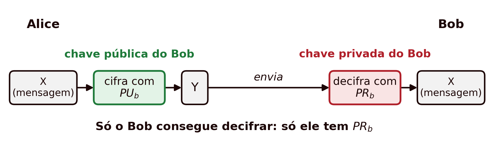
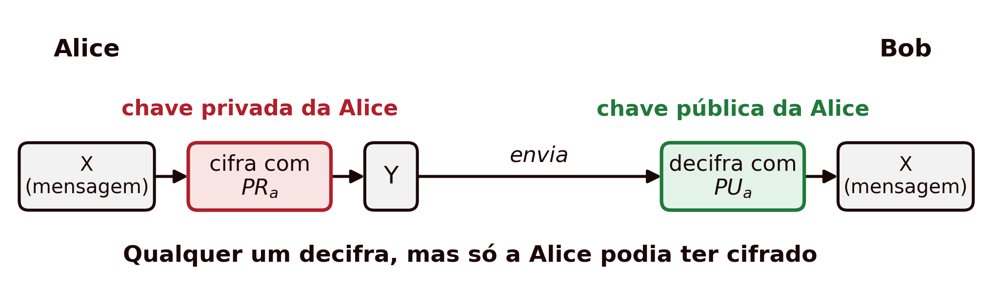
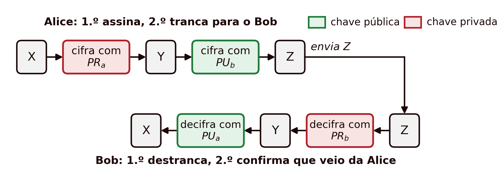
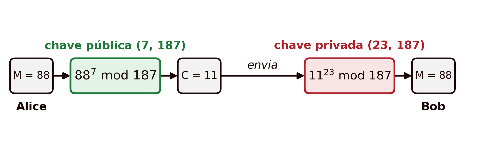
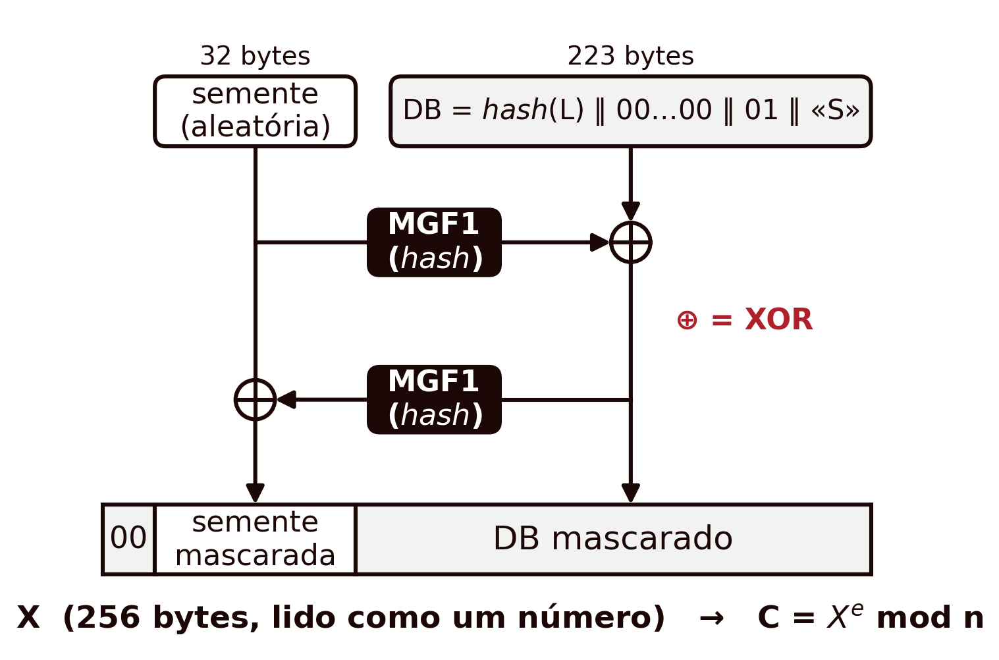
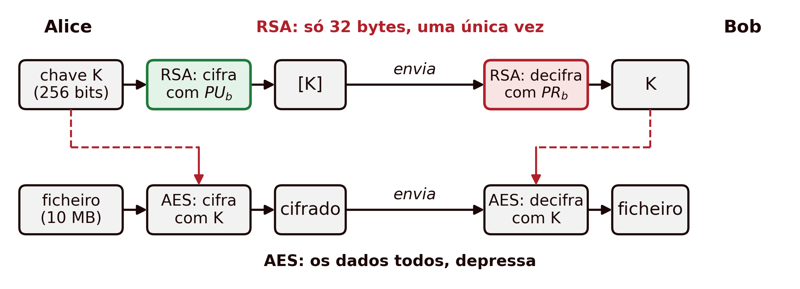

## Introdução {#sec-06-intro .unnumbered}

As cifras simétricas, das cifras clássicas ao AES, e também o HMAC, partilham uma limitação estrutural: exigem uma chave secreta **partilhada previamente** entre emissor e recetor. Suponha-se que a Alice, em Vila Real, quer enviar ao Bob, em Lisboa, um ficheiro cifrado com AES:

1. O AES precisa de uma chave $K$ que os **dois** conheçam.
2. Se a Alice enviar $K$ pela Internet, sem proteção, um atacante (o Darth) lê-a pelo caminho.
3. Para cifrar $K$, a Alice precisaria de outra chave, já combinada com o Bob, e o problema repete-se.
4. Encontrarem-se pessoalmente não escala: numa empresa com 1000 pessoas, cada par precisa da sua própria chave, ou seja, $1000 \times 999 / 2 = 499\,500$ chaves.

Este é o **problema da distribuição de chaves**, e durante décadas não teve resposta satisfatória. A solução, proposta por Diffie e Hellman em 1976 e concretizada por Rivest, Shamir e Adleman em 1977 com o algoritmo que dá nome a este capítulo, é radical: em vez de uma chave partilhada, cada participante passa a ter **duas chaves matematicamente relacionadas**, uma que pode divulgar livremente e outra que nunca revela a ninguém.

## Criptografia Assimétrica: o Conceito {#sec-06-conceito}

Uma analogia ajuda a perceber a ideia. O Bob compra muitos cadeados iguais e distribui-os **abertos** a quem os pedir, mas guarda só para si a chave que os abre. A Alice mete a mensagem numa caixa e fecha-a com um dos cadeados do Bob: para fechar basta carregar, não é precisa chave nenhuma. Depois de fechada, nem a própria Alice consegue abrir a caixa; só o Bob.

Na criptografia assimétrica, o cadeado aberto é a **chave pública** ($PU$), que se divulga a toda a gente, e a chave do cadeado é a **chave privada** ($PR$), que nunca sai do dono. Um sistema de chave pública assenta em seis componentes [@Stallings2020]:

| Componente | Papel |
|---|---|
| Texto claro $X$ | a mensagem original |
| Algoritmo de cifragem $E$ | transforma $X$ usando uma das chaves |
| Texto cifrado $Y$ | o que viaja pela rede |
| Algoritmo de decifragem $D$ | recupera $X$ usando a outra chave |
| Chave pública $PU$ | conhecida por todos |
| Chave privada $PR$ | conhecida só pelo dono |

: Os seis componentes de um sistema de chave pública {#tbl-06-componentes}

A propriedade que torna isto útil é puramente matemática: o que se cifrar com uma das chaves de um par só se decifra com a outra, nunca com a mesma. Na notação usada a seguir, $PU_b$ e $PR_b$ são as chaves do Bob, e $PU_a$ e $PR_a$ as da Alice. Escolher que chave usar para quê dá origem a dois esquemas distintos, com propósitos opostos.

**Confidencialidade.** Para enviar uma mensagem confidencial ao Bob, a Alice cifra-a com a **chave pública do Bob** ($PU_b$), que qualquer pessoa conhece:

$$Y = E[PU_b, X] \qquad X = D[PR_b, Y]$$

{#fig-06-confidencialidade width=100%}

Só o Bob consegue decifrar $Y$, porque só ele tem $PR_b$. O Darth também conhece $PU_b$, mas com ela não consegue desfazer a cifragem. Isto resolve exatamente o problema identificado na introdução: a Alice nunca precisou de combinar nenhum segredo com o Bob, só precisou de conhecer uma chave que está à vista de todos.

**Autenticação.** Para provar que uma mensagem vem mesmo da Alice, as chaves trocam de papel: ela cifra-a com a sua própria **chave privada** ($PR_a$):

$$Y = E[PR_a, X] \qquad X = D[PU_a, Y]$$

{#fig-06-autenticacao width=100%}

Qualquer pessoa pode decifrar $Y$ com a chave pública da Alice, $PU_a$, que também é livremente conhecida, e é precisamente por isso que este esquema não dá confidencialidade nenhuma. O que dá é a garantia de quem enviou: se $PU_a$ decifra $Y$, então $Y$ foi produzido com $PR_a$, e só a Alice a possui. É esta a ideia por trás da **assinatura digital**.

**As duas ao mesmo tempo.** Nada impede combinar os dois esquemas. A Alice primeiro cifra com a sua própria chave privada (assina) e depois cifra o resultado com a chave pública do Bob (garante a confidencialidade):

$$Z = E[PU_b,\, E[PR_a, X]] \qquad X = D[PU_a,\, D[PR_b, Z]]$$

{#fig-06-combinado width=100%}

Só o Bob consegue abrir $Z$, e lá dentro encontra um $Y$ que só a Alice podia ter produzido: fica com a certeza de que a mensagem veio da Alice e com a garantia de que mais ninguém a leu pelo caminho.

## Categorias e Aplicações {#sec-06-categorias}

Os algoritmos de chave pública têm três utilizações possíveis:

- **Cifrar e decifrar**, para obter confidencialidade;
- **Assinatura digital**, para provar quem produziu uma mensagem;
- **Troca de chaves**, para que as duas partes fiquem a partilhar uma chave secreta (por exemplo, uma chave de AES).

Nem todos os algoritmos servem as três:

| Algoritmo | Cifrar/Decifrar | Assinatura Digital | Troca de Chaves |
|---|:---:|:---:|:---:|
| RSA | Sim | Sim | Sim |
| Curva Elíptica | Sim | Sim | Sim |
| Diffie-Hellman | Não | Não | Sim |
| DSS | Não | Sim | Não |

: Aplicações dos principais algoritmos de chave pública [@Stallings2020] {#tbl-06-aplicacoes}

O RSA, apresentado neste capítulo, é, ao lado da criptografia de curva elíptica, capaz de servir os três papéis. O Diffie-Hellman serve apenas para combinar uma chave partilhada; o DSS existe apenas para assinar.

## A Matemática Necessária {#sec-06-matematica}

O RSA usa apenas três ideias de aritmética, apresentadas aqui antes do algoritmo.

**O resto da divisão.** $a \bmod n$ é o **resto** da divisão inteira de $a$ por $n$. Um relógio faz isto: 14 horas são as 2 da tarde, porque $14 \bmod 12 = 2$. Da mesma forma, $200 \bmod 187 = 13$, porque $200 = 1 \times 187 + 13$, e $161 \bmod 160 = 1$, porque $161 = 1 \times 160 + 1$. Uma consequência importante: o resultado de "$\bmod\ n$" está **sempre entre $0$ e $n-1$**, por maior que seja o número de partida.

**Primos e números coprimos.** Um **número primo** só é divisível por 1 e por si próprio (2, 3, 5, 7, 11, 13, 17, ...). O **máximo divisor comum**, $\text{mdc}(a, b)$, é o maior número que divide $a$ e $b$ ao mesmo tempo, e $a$ e $b$ dizem-se **coprimos** quando $\text{mdc}(a, b) = 1$, ou seja, quando não partilham nenhum fator:

| Par | Fatores | mdc | Coprimos? |
|---|---|:---:|:---:|
| 6 e 160 | $6 = 2 \times 3$; $160 = 2^5 \times 5$ | 2 | Não |
| 7 e 160 | $7$ é primo e não divide 160 | 1 | Sim |

: Exemplos de pares coprimos e não coprimos {#tbl-06-coprimos}

**O inverso modular.** Na aritmética normal, o inverso de 3 é $\frac{1}{3}$, porque $3 \times \frac{1}{3} = 1$. Em aritmética módulo 160 não há frações: o **inverso de 7 módulo 160** é o número inteiro $d$ tal que

$$7 \times d \bmod 160 = 1$$

Procura-se, portanto, um múltiplo de 7 que fique uma unidade acima de um múltiplo de 160:

| $d$ | 1 | 2 | ... | 22 | 23 |
|---|:---:|:---:|:---:|:---:|:---:|
| $7 \times d$ | 7 | 14 | ... | 154 | 161 |
| $7 \times d \bmod 160$ | 7 | 14 | ... | 154 | **1** |

: Procura do inverso de 7 módulo 160 {#tbl-06-inverso}

O inverso de 7 módulo 160 é 23. Este inverso só existe porque 7 e 160 são coprimos: com 6, que partilha o fator 2 com 160, os produtos $6 \times d$ são sempre pares, e um número par menos um múltiplo de 160 nunca dá 1.

## RSA: Geração de Chaves {#sec-06-rsa-geracao}

O **RSA** (Rivest, Shamir e Adleman, 1977) continua a ser o algoritmo de chave pública mais usado na prática. A geração do par de chaves segue cinco passos:

1. Escolhem-se dois números primos grandes e aleatórios, $p$ e $q$.
2. Calcula-se o **módulo** $n = p \times q$, que será público.
3. Calcula-se $\phi(n) = (p-1)(q-1)$, que tem de se manter secreto.
4. Escolhe-se $e$, coprimo com $\phi(n)$, com $1 < e < \phi(n)$.
5. Calcula-se $d$, o **inverso** de $e$ módulo $\phi(n)$: $e \times d \bmod \phi(n) = 1$.

A **chave pública** é o par $(e, n)$; a **chave privada** é o par $(d, n)$. O módulo $n$ é público, mas $p$, $q$ e $\phi(n)$ nunca são divulgados: quem os conhecer consegue calcular $d$.

Um exemplo completo, com números pequenos apenas para se conseguir fazer as contas à mão:

1. $p = 17$ e $q = 11$.
2. $n = 17 \times 11 = 187$.
3. $\phi(n) = 16 \times 10 = 160$.
4. $e = 7$, porque $\text{mdc}(7, 160) = 1$.
5. $d = 23$, porque $7 \times 23 = 161$ e $161 \bmod 160 = 1$ (@tbl-06-inverso).

A chave pública do Bob é $(7, 187)$ e a chave privada é $(23, 187)$.

## RSA: Cifragem e Decifragem {#sec-06-rsa-cifra}

No RSA, a mensagem é um **número** $M$, entre $0$ e $n-1$; um texto converte-se em números, por exemplo, pelos códigos dos seus carateres. Cifrar e decifrar resume-se a uma exponenciação modular:

$$C = M^e \bmod n \qquad\qquad M = C^d \bmod n$$

{#fig-06-exemplo-88 width=100%}

No exemplo, a Alice cifra $M = 88$ com a chave pública do Bob, $C = 88^7 \bmod 187 = 11$, e o Bob decifra com a sua chave privada, $M = 11^{23} \bmod 187 = 88$.

### Calcular as Potências à Mão {#sec-06-quadrados}

$88^7 = 40\,867\,559\,636\,992$ já é um número grande, e com expoentes de centenas de algarismos o cálculo direto seria impossível. O truque é **reduzir módulo $n$ a cada passo**:

1. Decompõe-se o expoente em potências de 2: $7 = 4 + 2 + 1$, logo $88^7 = 88^4 \times 88^2 \times 88^1$.
2. $88^1 \bmod 187 = 88$.
3. $88^2 = 7744$, e $7744 \bmod 187 = 77$.
4. $88^4 = (88^2)^2$, logo basta calcular $77^2 = 5929$, e $5929 \bmod 187 = 132$.
5. Multiplica-se tudo: $132 \times 77 \times 88 = 894\,432$, e $894\,432 \bmod 187 = 11$.

Os números intermédios nunca passam muito de $187^2$. É assim que os computadores fazem, mesmo com $n$ de milhares de bits, e o método chama-se **exponenciação por quadrados sucessivos** (*square-and-multiply*).

Para decifrar, o Bob faz o mesmo com o expoente $d = 23 = 16 + 4 + 2 + 1$, elevando sempre ao quadrado o resultado anterior:

| Potência | $11^1$ | $11^2$ | $11^4$ | $11^8$ | $11^{16}$ |
|---|:---:|:---:|:---:|:---:|:---:|
| $\bmod 187$ | **11** | **121** | **55** | 33 | **154** |

: Quadrados sucessivos de 11 módulo 187 {#tbl-06-quadrados}

$$11^{23} = 11^{16} \times 11^4 \times 11^2 \times 11^1 \;\rightarrow\; 154 \times 55 \times 121 \times 11 = 11\,273\,570, \qquad 11\,273\,570 \bmod 187 = 88$$

O Bob recuperou a mensagem da Alice.

### Porque Volta a Dar 88? {#sec-06-porque}

Cifrar e decifrar seguidos é elevar a $e$ e depois a $d$:

$$(M^e)^d = M^{e \times d} = M^{161}$$

$e$ e $d$ foram escolhidos de modo que $e \times d = 161 = 160 + 1$, ou seja, $e \times d \bmod \phi(n) = 1$. Com $n = 187$, elevar a 161 devolve sempre o número de partida, $M^{161} \bmod 187 = M$:

| $M$ | 2 | 5 | 88 |
|---|:---:|:---:|:---:|
| $C = M^7 \bmod 187$ | 128 | 146 | 11 |
| $C^{23} \bmod 187$ | 2 | 5 | 88 |

: Cifrar com $e = 7$ e decifrar com $d = 23$ devolve a mensagem original {#tbl-06-volta}

A propriedade verifica-se para todos os $M$ de 0 a 186. A demonstração geral vem da teoria dos números (teorema de Euler) [@Stallings2020].

## Segurança: Fatorizar $n$ {#sec-06-rsa-seguranca}

No exemplo, o Darth conhece a chave pública, $e = 7$ e $n = 187$, o algoritmo RSA e o texto cifrado $C = 11$. Não conhece $d = 23$, nem $p = 17$ e $q = 11$, nem $\phi(n) = 160$. A cadeia de dependências é a seguinte: para calcular $d$, precisa de $\phi(n)$; para calcular $\phi(n) = (p-1)(q-1)$, precisa de $p$ e $q$; e para obter $p$ e $q$, tem de **fatorizar** $n$, isto é, descobrir que primos, multiplicados, dão 187.

Com $n = 187$, o ataque é imediato. O Darth divide 187 por cada primo, por ordem:

1. $187 \div 2$, $187 \div 3$, $187 \div 5$ e $187 \div 7$: nenhuma divisão é exata.
2. $187 \div 11 = 17$: encontrou $p = 17$ e $q = 11$.
3. Calcula $\phi(n) = 16 \times 10 = 160$.
4. Calcula o inverso de $e = 7$ módulo 160: $d = 23$.
5. Decifra tudo o que for enviado ao Bob: $11^{23} \bmod 187 = 88$.

Basta testar primos até $\sqrt{187} \approx 13{,}7$, porque, se os dois fatores fossem maiores do que isso, o produto passaria de 187. São no máximo seis divisões (2, 3, 5, 7, 11 e 13). Qualquer $n$ de 8 bits (menor do que 256) cai assim: a segurança é nula.

Na prática, $n$ tem **2048 a 4096 bits**, um número de 617 a 1234 algarismos. Os primos até $\sqrt{n}$ são mais de $10^{305}$, e testá-los um a um é impossível. Multiplicar $p \times q$ é instantâneo, mas desfazer a multiplicação não tem nenhum método rápido conhecido: é o **problema da fatorização de inteiros**, do qual depende toda a segurança do RSA.

Isto não quer dizer que a fatorização só se faça por tentativa. Em 1991, a empresa RSA Laboratories publicou uma lista de módulos como desafio público, com nomes do tipo RSA-*número de algarismos*. O recorde atual é o **RSA-250**, com 250 algarismos (829 bits), fatorizado em 2020: um único processador levaria cerca de 2700 anos, e repartido por milhares de computadores demorou alguns meses. O melhor método conhecido, o *General Number Field Sieve* (GNFS), tem complexidade **subexponencial**: cresce mais lentamente do que uma pesquisa exaustiva, mas mais depressa do que um algoritmo polinomial [@Stallings2020]. É a existência deste atalho, muito mais rápido do que tentar divisões, que obriga o RSA a usar chaves muito maiores do que as de uma cifra simétrica para o mesmo nível de segurança:

| Segurança equivalente (bits) | 112 (3DES) | 128 | 192 | 256 |
|---|:---:|:---:|:---:|:---:|
| Módulo RSA equivalente (bits) | 2048 | 3072 | 7680 | 15 360 |

: Tamanho do módulo RSA para cada nível de segurança [@NIST80057] {#tbl-06-tamanhos}

## Uma Chave RSA Real {#sec-06-chave-real}

O `openssl` gera e mostra um par de chaves RSA de 2048 bits:

```bash
$ openssl genpkey -algorithm RSA -pkeyopt rsa_keygen_bits:2048 -out bob.pem
$ openssl pkey -in bob.pem -text -noout
Private-Key: (2048 bit, 2 primes)
modulus:
    00:da:2c:3c:33:c6:c3:1a:7d:7a:e2:cc:af:74:48: ...
publicExponent: 65537 (0x10001)
privateExponent:
    61:44:4b:6a:c1:f8:85:bc:df:a6:71:9e:df:76:fa: ...
prime1:
    00:ee:f1:6c:4f:11:2f:fd:f9:8e:ba:17:29:c6:93: ...
prime2:
    00:e9:bf:3e:ad:10:df:07:59:b3:ff:48:88:88:b0: ...
```

| Comando ou campo | Significado |
|---|---|
| `genpkey -algorithm RSA` | gera um par de chaves RSA novo |
| `-pkeyopt rsa_keygen_bits:2048` | com um módulo $n$ de 2048 bits |
| `-out bob.pem` | grava a chave privada (que inclui a pública) em `bob.pem` |
| `pkey -in bob.pem -text -noout` | mostra os números da chave em texto |
| `modulus`, `publicExponent`, `privateExponent`, `prime1`, `prime2` | $n$, $e$, $d$, $p$ e $q$ |

: Comandos e campos do exemplo {#tbl-06-openssl-chave}

Os valores estão em **hexadecimal**: cada par de carateres é um byte, e os ":" só separam os bytes para facilitar a leitura; o `00` inicial apenas indica que o número é positivo. Lido seguido, o `modulus` é um único número inteiro de 2048 bits, que em decimal teria 617 algarismos. `prime1` e `prime2` são $p$ e $q$: quem os tiver calcula $d$, e por isso o ficheiro da chave privada **nunca** se partilha.

O expoente público é $e = 65\,537$ em quase todas as chaves do mundo. Fixa-se primeiro o $e$ e só se aceitam primos $p$ e $q$ em que $p-1$ e $q-1$ não sejam múltiplos de 65 537, para que $e$ seja coprimo com $\phi(n)$. Falha cerca de um primo em cada 65 536, que simplesmente se troca por outro.

## O RSA "à Letra" e o RSA-OAEP {#sec-06-oaep}

Usar o RSA exatamente como descrito, o chamado ***textbook* RSA**, tem um problema: $C = M^e \bmod n$ dá **sempre** o mesmo $C$ para o mesmo $M$. Considere-se um voto cifrado com a chave pública do Bob, $(7, 187)$:

1. A Alice vota "S" (código 83) ou "N" (código 78) e envia $C$ ao Bob.
2. O Darth interceta $C = 8$.
3. O Darth também tem a chave pública: calcula $83^7 \bmod 187 = 8$ e $78^7 \bmod 187 = 56$.
4. Compara: $8 = 8$, a Alice votou "S".

O Darth não fatorizou nada, não descobriu $d$, e mesmo assim leu a mensagem. Quando há poucas mensagens possíveis, cifrar cada uma com a chave pública e comparar é suficiente. Por isso, nenhuma biblioteca criptográfica séria usa o RSA desta forma.

A solução é acrescentar aleatoriedade antes de cifrar. No **RSA-OAEP** (*Optimal Asymmetric Encryption Padding*), a mensagem é escondida com um **XOR** com bytes que dependem de um valor aleatório. Com uma chave de 2048 bits e o SHA-256:

1. A Alice gera 32 bytes aleatórios novos, a **semente**, só para esta mensagem.
2. Prepara o bloco **DB** (223 bytes): o voto "S", precedido de enchimento (o *hash* de uma etiqueta $L$, normalmente vazia, bytes 00 e um byte 01 que marca o início da mensagem).
3. Aplica o *hash* à semente repetidamente (função **MGF1**) até ter 223 bytes, a **máscara**, e faz o XOR: DB mascarado = DB $\oplus$ máscara.
4. Esconde também a semente, com um XOR com uma máscara calculada da mesma forma a partir do DB mascarado.
5. Concatena 00, a semente mascarada e o DB mascarado: 256 bytes, lidos como um único número $X$, que se cifra com o RSA normal, $C = X^e \bmod n$.

{#fig-06-oaep width=80%}

Para decifrar, o Bob desfaz estes passos pela ordem inversa:

1. Calcula $X = C^d \bmod n$ e parte-o nas posições fixas: o byte 00, a semente mascarada (32 bytes) e o DB mascarado (223 bytes).
2. Recupera a semente: a MGF1 aplicada ao DB mascarado dá a máscara da semente, e semente = semente mascarada $\oplus$ máscara.
3. Recupera o DB: a MGF1 aplicada à semente dá a máscara do DB, e DB = DB mascarado $\oplus$ máscara.
4. Verifica o enchimento: o DB tem de começar pelo *hash* de $L$, seguido de bytes 00 e de um byte 01, e o primeiro byte de $X$ tem de ser 00. Se tudo bater certo, o que vem depois do 01 é a mensagem; caso contrário, rejeita-a.

Isto funciona porque o XOR se anula a si próprio, $(a \oplus m) \oplus m = a$, e porque a MGF1 não tem segredo nenhum: com a mesma entrada, o Bob obtém exatamente as mesmas máscaras que a Alice. A ordem é obrigatória, porque a máscara do DB só se calcula depois de recuperada a semente. Os dois XOR não protegem nada por si: quem tivesse $X$ desfazia-os da mesma forma. O que impede o Darth de chegar a $X$ é a camada RSA, porque só o Bob tem $d$.

A etiqueta $L$ não viaja dentro de $C$: é combinada previamente entre a Alice e o Bob, como parte do protocolo que usam, e é quase sempre vazia. O Bob não a lê da mensagem; calcula o *hash* do $L$ que espera e compara-o com os primeiros 32 bytes do DB. A etiqueta serve para amarrar o texto cifrado a um contexto: com $L$ = "Eleição AE 2026", um $C$ reaproveitado noutra votação, com outra etiqueta, é rejeitado, embora a decifragem RSA corra bem. Mesmo com $L$ vazio, esses 32 bytes fixos funcionam como uma marca conhecida, que um $C$ forjado ou corrompido praticamente nunca acerta por acaso. No `openssl`, a etiqueta define-se com `-pkeyopt rsa_oaep_label:` seguido do valor em hexadecimal, tanto ao cifrar como ao decifrar.

Como a semente é nova a cada cifragem, as máscaras também o são, e $X$ e $C$ ficam completamente diferentes de uma vez para a outra. O Darth pode cifrar "S" e "N" quantas vezes quiser, e nunca obtém o $C$ da Alice. Para **assinaturas**, a versão correspondente chama-se **RSA-PSS** (*Probabilistic Signature Scheme*).

O `openssl` mostra o efeito: o mesmo ficheiro `voto.txt`, que contém só "S", cifrado duas vezes com OAEP, dá dois resultados sem nada em comum:

```bash
$ openssl pkey -in bob.pem -pubout -out bob_pub.pem
$ openssl pkeyutl -encrypt -pubin -inkey bob_pub.pem \
      -pkeyopt rsa_padding_mode:oaep -pkeyopt rsa_oaep_md:sha256 \
      -in voto.txt | xxd -p | head -c 48
7803e1d4fadef723e52938326ed6eeab43a7a0922a22d101
$ openssl pkeyutl -encrypt -pubin -inkey bob_pub.pem \
      -pkeyopt rsa_padding_mode:oaep -pkeyopt rsa_oaep_md:sha256 \
      -in voto.txt | xxd -p | head -c 48
2a682c7aca614db890b0c996708e3cb9d9fc67cae73cee1f
```

| Comando ou opção | Significado |
|---|---|
| `pkey -in bob.pem -pubout` | extrai do ficheiro da chave privada só a parte pública, $(e, n)$, e grava-a em `bob_pub.pem` |
| `pkeyutl -encrypt` | cifra um ficheiro com uma chave |
| `-pubin -inkey bob_pub.pem` | a chave a usar é pública e está em `bob_pub.pem` |
| `-pkeyopt rsa_padding_mode:oaep` | aplica o OAEP antes de cifrar |
| `-pkeyopt rsa_oaep_md:sha256` | o OAEP usa o SHA-256 (sem esta opção, o `openssl` usa o SHA-1) |
| `-in voto.txt` | o ficheiro a cifrar |
| `xxd -p` \| `head -c 48` | mostra o resultado em hexadecimal, só os primeiros 24 dos 256 bytes |
| `\` no fim da linha | o comando continua na linha seguinte |

: Comandos e opções do exemplo OAEP {#tbl-06-openssl-oaep}

## Na Prática: o RSA Transporta a Chave do AES {#sec-06-hibrido}

O RSA é **muito mais lento** do que o AES, e cada bloco tem de ser um número menor do que $n$: com 2048 bits, menos de 256 bytes. Por isso, na prática, o RSA cifra **só a chave $K$** do AES, uma vez, e os dados seguem cifrados com AES:

{#fig-06-hibrido width=100%}

É esta a resposta ao problema da introdução: a Alice gera uma chave $K$ aleatória, envia-a ao Bob cifrada com a chave pública dele, e a partir daí os dois usam a cifra simétrica, rápida, com uma chave que nunca viajou às claras.

## Síntese do Capítulo {#sec-06-sintese}

1. Cada participante tem uma **chave pública**, divulgada, e uma **chave privada**, secreta; o que uma cifra, só a outra decifra
2. Cifrar com a chave pública do **destinatário** dá confidencialidade; cifrar com a chave privada **própria** prova quem enviou; combinar as duas dá ambas
3. O RSA e a curva elíptica servem para cifrar, assinar e trocar chaves; o Diffie-Hellman só para trocar chaves, e o DSS só para assinar
4. **RSA**: $n = p \times q$, $e$ coprimo com $\phi(n) = (p-1)(q-1)$, $d$ inverso de $e$ módulo $\phi(n)$; $C = M^e \bmod n$ e $M = C^d \bmod n$, calculados por quadrados sucessivos
5. A segurança depende de ser impraticável **fatorizar** $n$; com $n = 187$ bastam seis divisões, por isso na prática $n$ tem 2048 a 4096 bits
6. O *textbook* RSA é determinístico: usa-se **RSA-OAEP** para cifrar e **RSA-PSS** para assinar
7. Na prática, o RSA cifra uma chave de AES, e o AES cifra os dados

## Para Pensar {#sec-06-reflexao}

O expoente público $e = 65\,537$ é o mesmo em milhões de chaves RSA diferentes, sem que isso comprometa nenhuma delas. No exemplo deste capítulo ($n = 187$), se o Bob trocasse $e = 7$ por um $e$ muito maior, mantendo o mesmo $n$, a chave ficaria mais segura? Porquê?

## Referências {#sec-06-referencias .unnumbered}

::: {#refs}
:::
