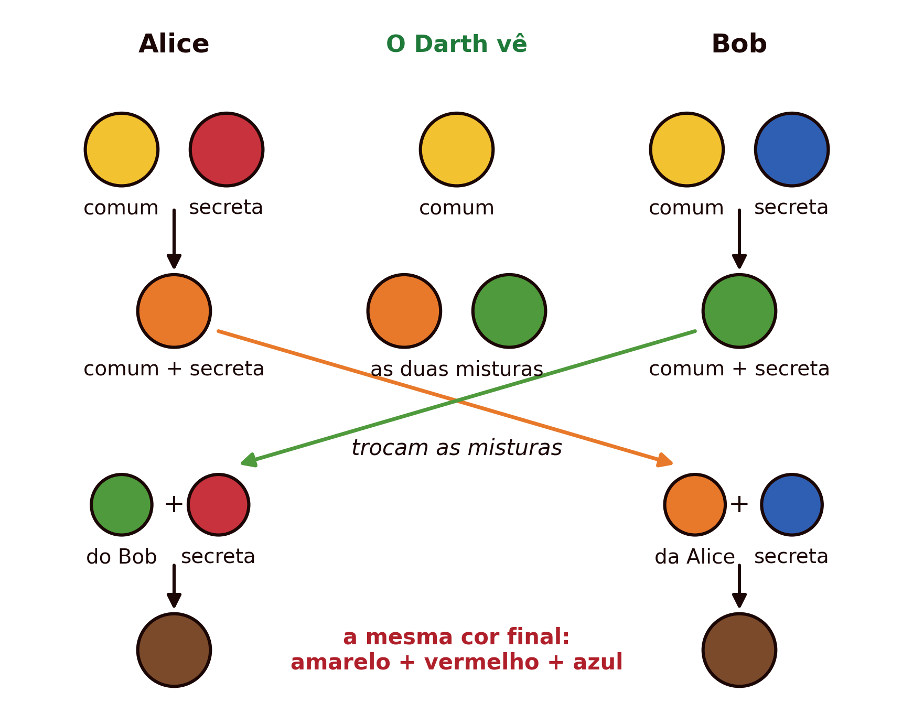
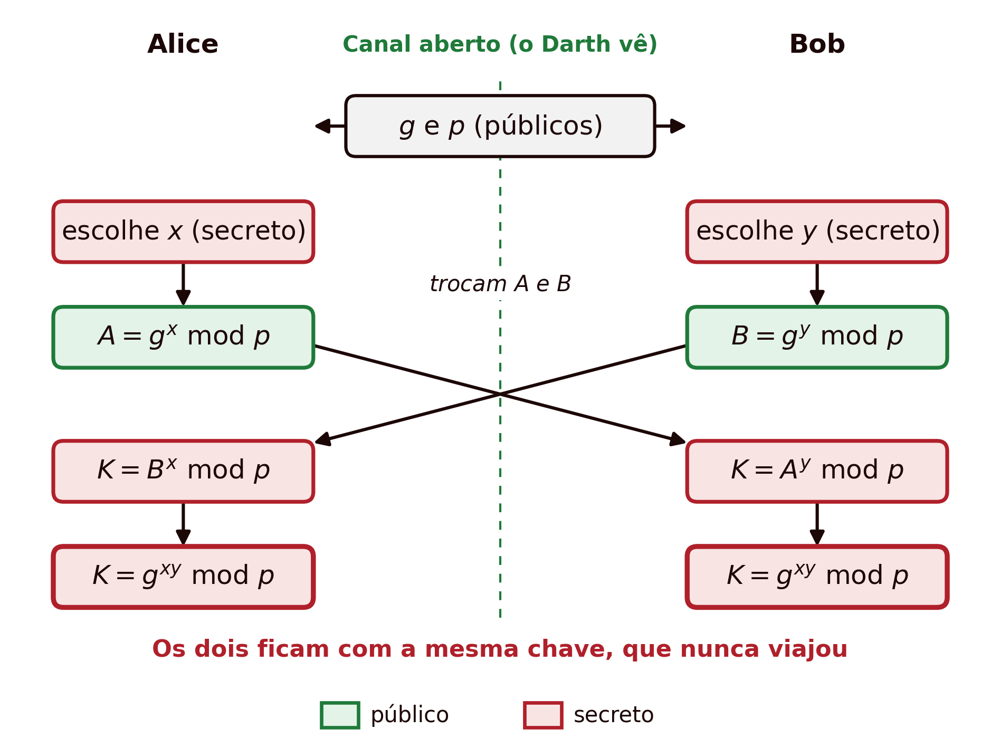
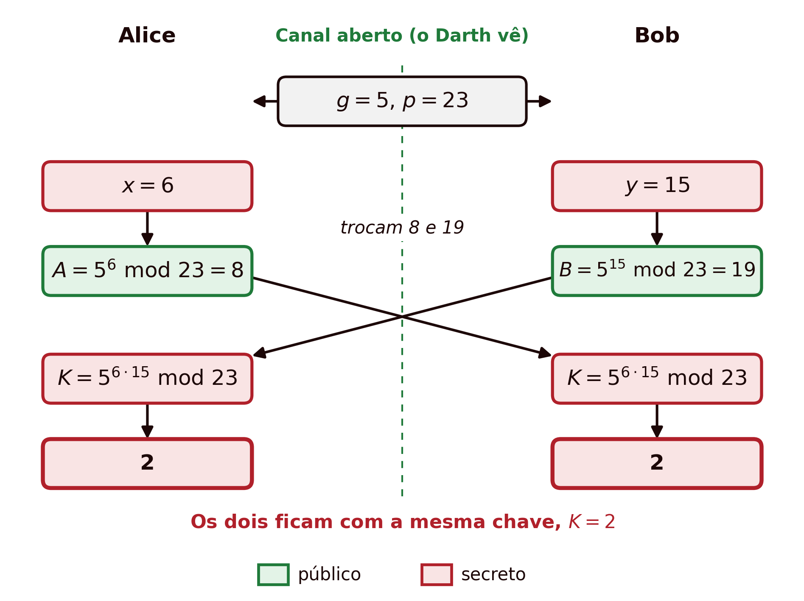
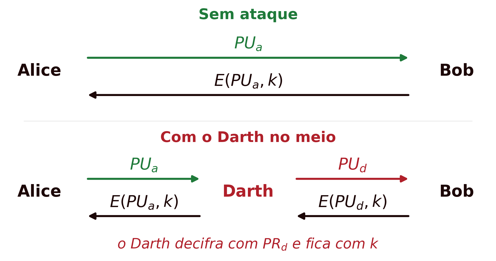
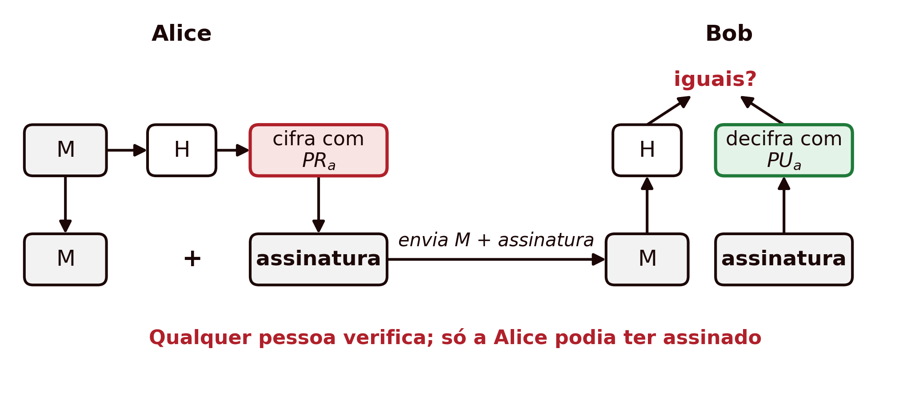
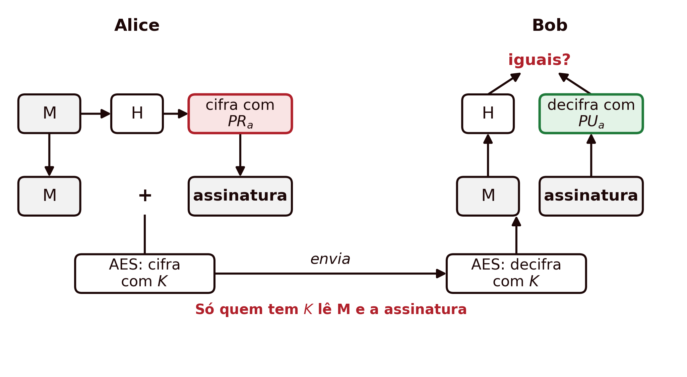
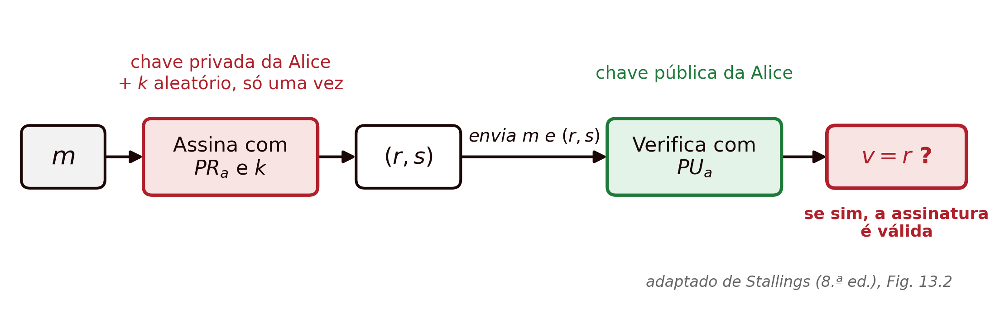
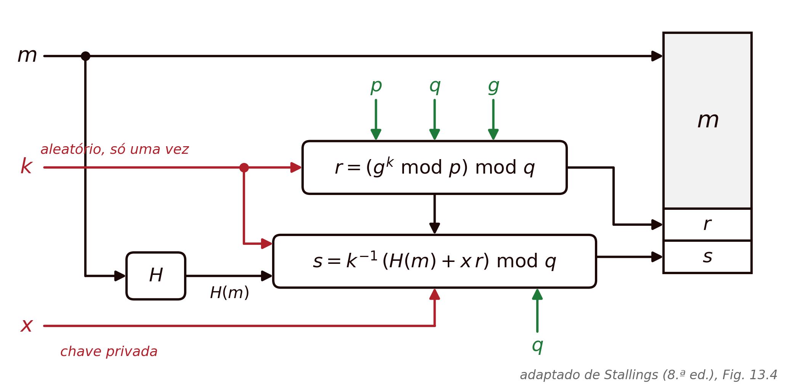
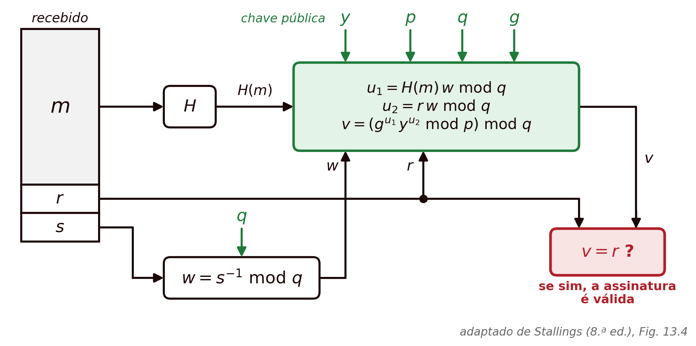
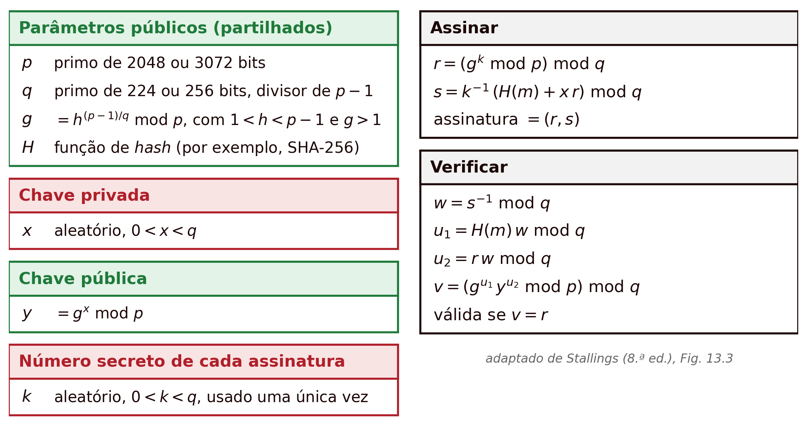

## Introdução {#sec-07-intro .unnumbered}

Com o RSA, a Alice gera uma chave $K$ para o AES e envia-a ao Bob, cifrada com a chave pública dele. Funciona, mas $K$ **viaja** pela rede, ainda que cifrada. Este capítulo trata de dois problemas diferentes que a criptografia de chave pública resolve. O primeiro é combinar uma chave secreta entre duas pessoas sem que essa chave alguma vez seja enviada: é o que faz o **Diffie-Hellman**. O segundo é provar, de forma que qualquer pessoa possa verificar, quem escreveu uma mensagem, sem que o autor possa depois negá-lo: é o papel das **assinaturas digitais**, com o RSA e com o **DSA**.

## Combinar uma Chave sem a Enviar {#sec-07-dh-conceito}

O **Diffie-Hellman** (1976) funciona assim:

1. A Alice e o Bob trocam mensagens à vista de todos.
2. No fim, os dois calculam **o mesmo número** $K$.
3. $K$ nunca é enviado: o Darth vê tudo o que passa e, mesmo assim, não o consegue calcular.
4. $K$ serve depois de chave para uma cifra simétrica, como o AES.

É um método de **troca de chaves**: não serve para cifrar mensagens nem para assinar.

A ideia percebe-se com tintas. A Alice e o Bob combinam em público uma cor comum, o amarelo. Cada um escolhe, em segredo, uma cor sua, junta-a ao amarelo e envia a mistura ao outro. No fim, cada um junta a sua cor secreta à mistura que recebeu, e os dois ficam com a mesma cor final, feita de amarelo e das duas cores secretas.

{#fig-07-tintas width=90%}

Misturar tintas é fácil; **separar** uma mistura nas cores de origem é praticamente impossível. O Darth vê o amarelo e as duas misturas, mas não consegue fazer a cor final, porque para isso precisava de uma das cores secretas.

## A Matemática Necessária {#sec-07-dh-matematica}

Na matemática, o papel da "mistura" é feito por uma **potência módulo um primo** $p$. Com $p = 23$ e $g = 5$:

| $x$ | 1 | 2 | 3 | 4 | 5 | 6 | 7 | 8 | 9 | 10 | 11 |
|---|:---:|:---:|:---:|:---:|:---:|:---:|:---:|:---:|:---:|:---:|:---:|
| $5^x \bmod 23$ | 5 | 2 | 10 | 4 | 20 | **8** | 17 | 16 | 11 | 9 | 22 |
| $x$ | **12** | **13** | **14** | **15** | **16** | **17** | **18** | **19** | **20** | **21** | **22** |
| $5^x \bmod 23$ | 18 | 21 | 13 | **19** | 3 | 15 | 6 | 7 | 12 | 14 | 1 |

: Potências de 5 módulo 23 {#tbl-07-potencias}

Os resultados saltam de forma irregular, sem ordem aparente. O 5 é um **gerador**: as suas potências passam por **todos** os valores de 1 a 22 antes de se repetirem. Nem todos os números têm esta propriedade: as potências de 2, por exemplo, só dão 11 valores diferentes.

**Sem módulo**, desfazer uma potência é fácil. Se $5^x = 390\,625$, como $5^x$ cresce sempre, basta ir subindo até lá: $5^8 = 390\,625$, logo $x = 8$. É o logaritmo, $x = \log_5 390\,625$.

**Com módulo**, a ordem desaparece. Se $5^x \bmod 23 = 8$, o 8 não está "perto" de nenhum valor conhecido, e a única forma direta de encontrar $x$ é experimentar $x = 1, 2, 3, \ldots$ até acertar ($x = 6$).

| Sentido | Operação | Custo |
|---|---|---|
| Ida | dado $x$, calcular $g^x \bmod p$ | fácil (quadrados sucessivos) |
| Volta | dado $g^x \bmod p$, descobrir $x$ | **inviável** com $p$ grande |

: Os dois sentidos da potência módulo um primo {#tbl-07-sentidos}

A volta chama-se **problema do logaritmo discreto**, e é nele que assenta a segurança do Diffie-Hellman.

## O Algoritmo Diffie-Hellman {#sec-07-dh-algoritmo}

{#fig-07-dh width=80%}

1. Combinam-se, em público, um primo $p$ e um gerador $g$.
2. A Alice escolhe um segredo $x$; o Bob, um segredo $y$.
3. Trocam, em claro, $A = g^x \bmod p$ e $B = g^y \bmod p$: são as **chaves públicas** de cada um.
4. Cada um eleva o valor recebido ao **seu** segredo e obtém o mesmo $K$: a Alice calcula $B^x \bmod p$ e o Bob $A^y \bmod p$.

Com os números da @tbl-07-potencias, a Alice escolhe $x = 6$ e o Bob $y = 15$:

{#fig-07-dh-exemplo width=80%}

O 8 e o 19 leem-se diretamente na tabela. A Alice calcula $19^6 \bmod 23$ e o Bob $8^{15} \bmod 23$, por quadrados sucessivos, e os dois obtêm **2**.

Os dois chegam ao mesmo número porque elevar uma potência a outra potência multiplica os expoentes, e a ordem da multiplicação não importa:

$$\text{Alice: } B^x = (g^y)^x = g^{yx} \qquad\qquad \text{Bob: } A^y = (g^x)^y = g^{xy}$$

No exemplo, $(5^{15})^6 = 5^{90}$ e $(5^6)^{15} = 5^{90}$, e reduzir módulo 23 pelo caminho não altera o resultado final. Como as potências de 5 se repetem de 22 em 22, o expoente 90 dá o mesmo que $90 \bmod 22 = 2$, e $5^2 \bmod 23 = 2$. O resultado comum é

$$K = g^{xy} \bmod p$$

A Alice nunca soube $y$, o Bob nunca soube $x$, e $K$ nunca passou pela rede.

## Segurança do Diffie-Hellman {#sec-07-dh-seguranca}

| O Darth conhece | O Darth não conhece |
|---|---|
| $p = 23$ e $g = 5$ | $x = 6$ |
| $A = 8$ e $B = 19$ | $y = 15$ |
| o algoritmo | $K = 2$ |

: O que o Darth vê e o que lhe falta no exemplo {#tbl-07-darth}

Com $A$ e $B$ não chega: multiplicá-los ou elevar um ao outro não dá $K$. O Darth precisa de $x$ ou de $y$. Com $p = 23$, o ataque é imediato:

1. Experimenta $5^1, 5^2, 5^3, \ldots \bmod 23$ até obter $A = 8$, e encontra $x = 6$ à sexta tentativa.
2. Calcula $K = B^x = 19^6 \bmod 23 = 2$, tal como a Alice.

São no máximo 22 tentativas: a segurança é nula. Na prática, $p$ tem **2048 bits** ou mais, e há expoentes a mais para os experimentar um a um. Mas, tal como na fatorização do RSA, existe um atalho: uma variante do *General Number Field Sieve* (GNFS) resolve o logaritmo discreto em tempo **subexponencial**, muito mais depressa do que experimentar todos os expoentes [@Stallings2020]. Por isso, o Diffie-Hellman precisa de números do mesmo tamanho que o RSA para a mesma segurança:

| Segurança equivalente (bits) | 112 (3DES) | 128 | 192 | 256 |
|---|:---:|:---:|:---:|:---:|
| Primo $p$ do Diffie-Hellman (bits) | 2048 | 3072 | 7680 | 15 360 |

: Tamanho do primo $p$ para cada nível de segurança [@NIST80057] {#tbl-07-tamanhos}

O $p$ e o $g$ não precisam de ser gerados de novo em cada troca: usam-se **grupos normalizados**, publicados para toda a gente usar. O grupo `ffdhe2048`, por exemplo, tem um $p$ de 2048 bits e $g = 2$.

## Diffie-Hellman no `openssl` {#sec-07-dh-openssl}

O `openssl` faz a troca completa com o grupo `ffdhe2048`:

```bash
$ openssl genpkey -algorithm DH -pkeyopt group:ffdhe2048 -out alice.pem
$ openssl genpkey -algorithm DH -pkeyopt group:ffdhe2048 -out bob.pem
$ openssl pkey -in alice.pem -pubout -out alice_pub.pem
$ openssl pkey -in bob.pem -pubout -out bob_pub.pem
$ openssl pkeyutl -derive -inkey alice.pem -peerkey bob_pub.pem | xxd -p | head -c 48
e0d709b889817a241db4f4c6116533e746119833b3128ca3
$ openssl pkeyutl -derive -inkey bob.pem -peerkey alice_pub.pem | xxd -p | head -c 48
e0d709b889817a241db4f4c6116533e746119833b3128ca3
```

| Comando ou opção | Significado |
|---|---|
| `genpkey -algorithm DH -pkeyopt group:ffdhe2048` | escolhe um segredo ($x$ ou $y$) e calcula a chave pública ($A$ ou $B$) com o $p$ e o $g$ do grupo `ffdhe2048` |
| `-out alice.pem` | grava o segredo e a chave pública em `alice.pem` |
| `pkey -in alice.pem -pubout -out alice_pub.pem` | guarda à parte só a chave pública, a que se envia ao outro |
| `pkeyutl -derive -inkey alice.pem -peerkey bob_pub.pem` | a Alice calcula $K = B^x \bmod p$ com o seu segredo e a chave pública do Bob |
| `xxd -p` \| `head -c 48` | mostra $K$ em hexadecimal, só os primeiros 24 dos 256 bytes |

: Comandos e opções do exemplo Diffie-Hellman {#tbl-07-openssl-dh}

Os dois comandos `-derive` dão o **mesmo** $K$, cada um do seu lado, sem que $K$ tenha sido enviado.

## O Ataque do Intermediário {#sec-07-mitm}

Qualquer troca de chaves públicas tem uma fragilidade, que se vê bem num caso simples: a Alice envia ao Bob a sua chave pública $PU_a$, e o Bob gera uma chave $k$ para o AES e devolve-a cifrada, $E(PU_a, k)$.

{#fig-07-mitm width=85%}

O Darth, num ponto da rede entre os dois (por exemplo, um *router* comprometido), interceta $PU_a$ e entrega ao Bob, em vez dela, a sua própria chave pública, $PU_d$. O Bob, sem saber, cifra $k$ com $PU_d$. O Darth decifra com a sua chave privada $PR_d$, fica com $k$, volta a cifrá-la com $PU_a$ e entrega-a à Alice. Os dois continuam a comunicar, cifrando tudo com $k$, sem saber que o Darth lê todas as mensagens.

É o **ataque do intermediário** (*man-in-the-middle*, MITM). No Diffie-Hellman, funciona da mesma forma: o Darth faz uma troca com a Alice e outra com o Bob, fica com uma chave combinada com cada um, e decifra e volta a cifrar tudo o que passa. O problema não está na matemática, que continua intacta, mas no facto de nenhum dos dois saber **de quem** é a chave pública que recebeu.

## Assinaturas Digitais: o Conceito {#sec-07-assinaturas-conceito}

Uma assinatura digital tem de garantir três coisas:

| Propriedade | Pergunta a que responde |
|---|---|
| **Autenticação** | Quem produziu a mensagem? |
| **Integridade** | A mensagem foi alterada depois de assinada? |
| **Não repúdio** | O autor pode negar que a assinou? |

: As três propriedades de uma assinatura digital {#tbl-07-propriedades}

O HMAC já dá as duas primeiras, mas não a terceira. A chave do HMAC é **partilhada**: a Alice e o Bob conseguem ambos calcular a marca. Se o Bob mostrar a um juiz uma mensagem com um HMAC válido, a Alice pode sempre dizer que foi o Bob quem a fez. Com uma **chave privada**, só a Alice podia ter assinado, e não há como negar.

### Assinar o *Hash* {#sec-07-assinar-hash}

{#fig-07-assinar width=100%}

1. A Alice calcula o *hash* da mensagem, $H(M)$, e cifra-o com a sua chave **privada**: é a assinatura.
2. Envia $M$ e a assinatura, lado a lado.
3. O Bob calcula $H(M)$ sobre a mensagem que recebeu, decifra a assinatura com a chave **pública** da Alice e compara os dois valores: se forem iguais, a assinatura é válida.

Assina-se o *hash* e não a mensagem, porque o *hash* é curto, tem tamanho fixo, e o RSA é lento.

Neste esquema, $M$ viaja **em claro**: qualquer pessoa a lê. A assinatura prova quem escreveu, mas não esconde nada. Se for preciso confidencialidade, cifra-se o conjunto (mensagem e assinatura) com uma cifra simétrica, como o AES, com uma chave $K$ combinada entre os dois, por exemplo com o Diffie-Hellman:

{#fig-07-assinar-cifrar width=100%}

### Exemplo com o RSA {#sec-07-assinar-rsa}

A Alice tem um par de chaves RSA com números pequenos: pública $(7, 187)$, privada $(23, 187)$. Para ser possível fazer as contas à mão, suponha-se que $H(M) = 99$.

1. A Alice assina com a chave privada: $99^{23} \bmod 187 = 176$.
2. Envia $M$ e a assinatura, 176.
3. O Bob calcula $H(M) = 99$ sobre a mensagem recebida.
4. Decifra a assinatura com a chave pública da Alice: $176^{7} \bmod 187 = 99$.
5. $99 = 99$: a assinatura é válida.

Se o Darth alterar $M$ pelo caminho, o *hash* muda (por exemplo, para 100) e deixa de bater certo com 99. Para criar uma assinatura nova para 100, o Darth precisaria de $d = 23$, que só a Alice tem.

Na prática, usa-se o **RSA-PSS** (*Probabilistic Signature Scheme*), que junta aleatoriedade ao *hash* antes de assinar, pela mesma razão que o OAEP o faz ao cifrar: sem ela, a mesma mensagem dá sempre a mesma assinatura.

### Assinar no `openssl` {#sec-07-assinar-openssl}

O ficheiro `ordem.txt` contém "Transferir 100 euros para o Bob". A Alice assina-o com uma chave RSA de 2048 bits, e o Bob verifica a assinatura antes e depois de alguém alterar o ficheiro:

```bash
$ openssl dgst -sha256 -sign alice_rsa.pem -sigopt rsa_padding_mode:pss \
      -out ordem.sig ordem.txt
$ openssl dgst -sha256 -verify alice_rsa_pub.pem -sigopt rsa_padding_mode:pss \
      -signature ordem.sig ordem.txt
Verified OK
$ echo "Transferir 900 euros para o Bob" > ordem.txt
$ openssl dgst -sha256 -verify alice_rsa_pub.pem -sigopt rsa_padding_mode:pss \
      -signature ordem.sig ordem.txt
Verification failure
```

| Comando ou opção | Significado |
|---|---|
| `dgst -sha256 -sign alice_rsa.pem` | calcula o SHA-256 do ficheiro e assina-o com a chave privada da Alice |
| `-sigopt rsa_padding_mode:pss` | usa o RSA-PSS |
| `-out ordem.sig ordem.txt` | grava a assinatura (256 bytes) em `ordem.sig`; o ficheiro assinado é `ordem.txt` |
| `-verify alice_rsa_pub.pem -signature ordem.sig` | verifica a assinatura com a chave pública da Alice |
| `echo "..." > ordem.txt` | altera o ficheiro: 100 passa a 900 |
| `\` no fim da linha | o comando continua na linha seguinte |

: Comandos e opções do exemplo de assinatura {#tbl-07-openssl-assinar}

Basta mudar um algarismo para que a verificação falhe: o *hash* do ficheiro alterado já não corresponde ao que foi assinado.

## O DSA {#sec-07-dsa}

O RSA serve para cifrar e para assinar. O **DSA** (*Digital Signature Algorithm*) foi desenhado só para assinar:

- baseia-se no mesmo problema do Diffie-Hellman, o **logaritmo discreto**;
- garante autenticação, integridade e não repúdio;
- foi normalizado em 1994 no **DSS** (*Digital Signature Standard*, norma FIPS 186);
- usa um número aleatório novo em **cada** assinatura, pelo que assinar duas vezes a mesma mensagem dá assinaturas diferentes.

A versão atual da norma, a FIPS 186-5, de 2023, já não aprova o DSA para criar assinaturas novas, só para verificar as antigas [@FIPS1865]. A sua estrutura continua, no entanto, nos algoritmos que o substituíram, e é por isso que vale a pena percebê-la.

Visto de longe, o DSA tem a mesma forma da assinatura com o RSA: a Alice assina com a sua chave privada, e qualquer pessoa verifica com a chave pública dela.

{#fig-07-dsa-simples width=100%}

Há duas diferenças. Entra um número aleatório $k$, novo em cada assinatura, e a assinatura é um par de números, $(r, s)$. Além disso, a verificação não decifra nada: calcula um valor $v$ a partir da mensagem, de $(r, s)$ e da chave pública, e compara-o com $r$.

### Assinar e Verificar {#sec-07-dsa-assinar}

Dentro da caixa "Assina", a Alice usa os parâmetros públicos $p$, $q$ e $g$, a sua chave privada $x$ e o número aleatório $k$:

{#fig-07-dsa-assinar width=100%}

$k^{-1}$ é o inverso de $k$ módulo $q$, o número que, multiplicado por $k$, dá 1 módulo $q$. O $s$ tem de cumprir quatro exigências ao mesmo tempo: depender da mensagem, provar que se usou $x$, não revelar $x$ nem $k$, e permitir a verificação a quem não conhece nenhum dos dois.

Do outro lado, o Bob só usa valores públicos: a mensagem, $(r, s)$, $p$, $q$, $g$ e a chave pública $y$ da Alice.

{#fig-07-dsa-verificar width=100%}

As contas reconstroem $g^k$, e portanto $r$, sem nunca conhecer $k$ nem $x$. Se a mensagem ou a assinatura tiverem sido alteradas, $v$ sai diferente de $r$. A @fig-07-dsa-tabela junta num só quadro todos os valores e fórmulas.

{#fig-07-dsa-tabela width=100%}

Na prática, $q$ tem 224 ou 256 bits e $p$ tem 2048 ou 3072 bits. Os dois primos estão ligados: $p - 1$ tem de ser múltiplo de $q$. A razão desta ligação explica-se mais abaixo, na secção sobre o ciclo de $q$ passos.

### Exemplo com Números Pequenos {#sec-07-dsa-exemplo}

Os parâmetros saem da receita da @fig-07-dsa-tabela: $q = 11$; $p = 23$, porque $22 = 2 \times 11$; com $h = 2$, $g = 2^{22/11} \bmod 23 = 2^2 = 4$. A Alice escolhe a chave privada $x = 5$, que guarda só para si, e publica $y = 4^5 \bmod 23 = 12$. Suponha-se $H(m) = 4$.

**A Alice assina** com $k = 8$:

1. $4^8 \bmod 23 = 9$, logo $r = 9 \bmod 11 = 9$.
2. $k^{-1} = 7$, porque $8 \times 7 = 56$ e $56 \bmod 11 = 1$.
3. $s = 7 \times (4 + 5 \times 9) \bmod 11 = 343 \bmod 11 = 2$.
4. A assinatura é $(r, s) = (9, 2)$.

**O Bob verifica**, só com a chave pública $y = 12$:

1. $w = 2^{-1} \bmod 11 = 6$, porque $2 \times 6 = 12$ e $12 \bmod 11 = 1$.
2. $u_1 = 4 \times 6 \bmod 11 = 2$.
3. $u_2 = 9 \times 6 \bmod 11 = 10$.
4. $4^2 \times 12^{10} \bmod 23 = 16 \times 2 \bmod 23 = 9$.
5. $v = 9 \bmod 11 = 9 = r$: a assinatura é **válida**.

### Porque Funciona a Verificação {#sec-07-dsa-porque}

Da fórmula de $s$, multiplicando os dois lados por $k$ e por $w = s^{-1}$, tira-se

$$k = w\,(H(m) + x\,r) = u_1 + u_2\,x \pmod q$$

No exemplo, $u_1 + u_2\,x = 2 + 10 \times 5 = 52$, e $52 \bmod 11 = 8$, que é o $k$ da Alice. Como $y = g^x$, o Bob calcula, sem conhecer $x$ nem $k$,

$$g^{u_1} \times y^{u_2} = g^{u_1} \times g^{x\,u_2} = g^{u_1 + x\,u_2} = g^{k} \pmod p$$

e reduz o resultado módulo $q$, obtendo exatamente o $r$ da Alice. Esta passagem tem um pormenor: o expoente $u_1 + x\,u_2$ foi calculado módulo $q$, e não é o mesmo número que $k$, apenas tem o mesmo resto na divisão por $q$. Isso só basta porque o $g$ do DSA foi escolhido de propósito para que as suas potências se repitam de $q$ em $q$.

### Porque é Preciso um Ciclo de $q$ Passos {#sec-07-dsa-ciclo}

Com $p = 23$ e $g = 4$, as potências de $g$ repetem-se ao fim de poucos passos:

| $i$ | 1 | 2 | 3 | 4 | 5 | 6 | 7 | 8 | 9 | 10 | 11 | 12 | 13 |
|---|:---:|:---:|:---:|:---:|:---:|:---:|:---:|:---:|:---:|:---:|:---:|:---:|:---:|
| $4^i \bmod 23$ | 4 | 16 | 18 | 3 | 12 | 2 | 8 | 9 | 13 | 6 | **1** | 4 | 16 |

: Potências de 4 módulo 23 {#tbl-07-ciclo}

Ao fim de 11 passos sai o 1, e daí em diante tudo se repete. Num expoente, só interessa então o resto da divisão por 11: $4^{12} \bmod 23 = 4 = 4^1$, porque $12 \bmod 11 = 1$. Ao comprimento deste ciclo chama-se $q$. Com um $g$ qualquer, isto falha: o 5 da @tbl-07-potencias só se repete ao fim de 22 passos, e $5^{12} \bmod 23 = 18$, enquanto $5^1 = 5$. Uma assinatura calculada com expoentes reduzidos módulo 11 e com $g = 5$ nunca seria aceite.

O DSA precisa deste ciclo por três razões:

1. **Tamanho e rapidez.** O $p$ tem de ser grande, 3072 bits, para o logaritmo discreto ser difícil. O $q$ pode ser muito mais pequeno, 256 bits. Como as contas da assinatura se fazem módulo $q$, a assinatura tem $2 \times 256 = 512$ bits, em vez de $2 \times 3072 = 6144$. E os expoentes (a chave privada e o número aleatório) têm 256 bits em vez de 3072, o que faz cada potência cerca de 12 vezes mais rápida.
2. **Divisões.** A assinatura usa $k^{-1}$ e a verificação usa $s^{-1}$. Estes inversos calculam-se módulo $q$, e com $q$ primo todos os números de 1 a $q - 1$ têm inverso. Se o módulo fosse $p - 1$, que é sempre par, metade dos números não teria inverso: módulo 22, por exemplo, 4 vezes qualquer número dá sempre um resultado par, nunca 1.
3. **Segurança.** Se o comprimento do ciclo tiver fatores pequenos (como $22 = 2 \times 11$), o logaritmo discreto pode ser atacado por partes. O método de Pohlig-Hellman descobre primeiro o resto do segredo na divisão por cada fator pequeno, o que é rápido, e depois junta os pedaços. Com um ciclo de comprimento primo e grande, não há partes: o atacante tem de enfrentar o ciclo inteiro de $q$ passos, e com $q$ de 256 bits os melhores métodos genéricos precisam de cerca de $2^{128}$ operações.

Resta ver porque é que a receita $g = h^{(p-1)/q} \bmod p$ dá um ciclo de exatamente $q$ passos:

1. **Pequeno teorema de Fermat.** Se $p$ é primo, para qualquer $h$ entre 2 e $p - 2$, $h^{p-1} \bmod p = 1$. Com $h = 2$: $2^{22} \bmod 23 = 1$.
2. **O $q$ desaparece.** Elevar $g$ a $q$ multiplica os expoentes, e dividir por $q$ e multiplicar por $q$ anulam-se: $g^q = \left(h^{(p-1)/q}\right)^q = h^{p-1}$. No exemplo, $4^{11} = (2^2)^{11} = 2^{22}$.
3. **O ciclo fecha.** Logo $g^q \bmod p = 1$, e ao fim de $q$ passos sai o 1: $4^{11} \bmod 23 = 1$, como na @tbl-07-ciclo.
4. **Porque $q$ é primo.** O ciclo de $g$ tem de caber um número inteiro de vezes em $q$. Se $q$ é primo, o ciclo só pode ter $q$ passos, ou 1 passo quando $g = 1$. É por isso que, se sair $g = 1$, se troca de $h$.

## Nunca Reutilizar $k$ {#sec-07-dsa-k}

O número $k$ tem de ser secreto e novo em cada assinatura. Suponha-se que a Alice assina duas mensagens com o **mesmo** $k = 8$: $H(m_1) = 6$ dá $(9, 5)$ e $H(m_2) = 4$ dá $(9, 2)$. Como $r = (g^k \bmod p) \bmod q$ só depende de $k$, o $r$ repete-se, e o Darth repara nisso:

1. Subtrai as duas equações de $s$. O termo $x\,r$ é igual nas duas e desaparece:
   $$s_1 - s_2 = k^{-1}\,(H(m_1) - H(m_2)) \bmod q$$
2. Isola $k$: $k = (H(m_1) - H(m_2)) \times (s_1 - s_2)^{-1} \bmod q$. Com os números do exemplo, $6 - 4 = 2$ e $s_1 - s_2 = 3$, cujo inverso é 4, porque $3 \times 4 = 12$ e $12 \bmod 11 = 1$. Logo, $k = 2 \times 4 \bmod 11 = 8$.
3. Isola $x$: $x = (s_1\,k - H(m_1)) \times r^{-1} \bmod q$. O inverso de $r = 9$ é 5, porque $9 \times 5 = 45$ e $45 \bmod 11 = 1$; então $x = (5 \times 8 - 6) \times 5 \bmod 11 = 170 \bmod 11 = 5$.

Duas assinaturas com o mesmo $k$ entregam a **chave privada**.

Este ataque não é só teórico. A PlayStation 3 só executava programas assinados pela Sony, com o ECDSA, uma variante do DSA com a mesma estrutura de $r$, $s$ e $k$. A implementação da Sony usava **sempre o mesmo $k$**, em vez de um número aleatório novo para cada assinatura. Em 2010, o grupo *fail0verflow* reparou que assinaturas diferentes tinham o mesmo $r$ e fez exatamente estas contas. Com a chave privada da Sony, passou a ser possível assinar qualquer programa como se fosse da Sony, e a consola executava-o. O algoritmo estava certo; bastou um erro na implementação.

## Depois do DSA {#sec-07-dsa-sucessores}

Os algoritmos que substituíram o DSA mantêm a sua estrutura de $r$, $s$ e $k$, e corrigem os seus dois defeitos: os números enormes (o $p$ do DSA precisa de 3072 bits para ser seguro) e a dependência do número aleatório $k$, que, se se repetir ou for previsível, expõe a chave privada.

| Substituto | O que corrige |
|---|---|
| **ECDSA** | Faz as mesmas contas sobre **curvas elípticas**, onde o logaritmo discreto é mais difícil: chegam 256 bits em vez de 3072. Continua a precisar de um $k$ aleatório em cada assinatura, e foi por isso que a PlayStation 3 caiu |
| **EdDSA** (Ed25519) | Também sobre curvas elípticas, mas o $k$ deixa de ser aleatório: é calculado a partir da chave privada e da mensagem. A mesma mensagem dá sempre o mesmo $k$, mensagens diferentes dão $k$ diferentes, e uma falha do gerador aleatório já não expõe a chave |

: Os substitutos do DSA {#tbl-07-sucessores tbl-colwidths="[22,78]"}

Os dois são aprovados pela norma FIPS 186-5, a par do RSA [@FIPS1865].

## Síntese do Capítulo {#sec-07-sintese}

1. O **Diffie-Hellman** permite combinar uma chave $K = g^{xy} \bmod p$ em público, sem que $K$ alguma vez viaje
2. A segurança assenta no **logaritmo discreto**: calcular $g^x \bmod p$ é fácil, descobrir $x$ é inviável com $p$ de 2048 bits ou mais
3. Sem saber **de quem** é a chave pública recebida, qualquer troca de chaves, incluindo o Diffie-Hellman, cai perante um **intermediário** (MITM)
4. Uma **assinatura digital** dá autenticação, integridade e **não repúdio**, que o HMAC não dá
5. Assina-se o ***hash*** da mensagem com a chave privada; verifica-se com a chave pública. Com o RSA, usa-se o RSA-PSS
6. O **DSA** assina com a chave privada $x$ e um número $k$ aleatório, e produz o par $(r, s)$; as contas fazem-se módulo $q$, o comprimento do ciclo das potências de $g$
7. Reutilizar $k$ entrega a chave privada; o ECDSA reduz o tamanho dos números e o EdDSA elimina a dependência do gerador aleatório

## Para Pensar {#sec-07-reflexao}

Para travar o ataque do intermediário, o Bob podia **assinar** o seu valor $B = 19$ antes de o enviar, e a Alice verificaria a assinatura com a chave pública do Bob. Isto resolve o problema? O que tem a Alice de saber, antes de começar, para que a verificação sirva de alguma coisa?

## Referências {#sec-07-referencias .unnumbered}

::: {#refs}
:::
