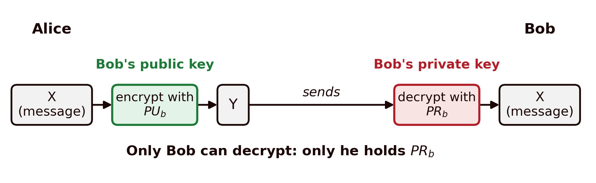
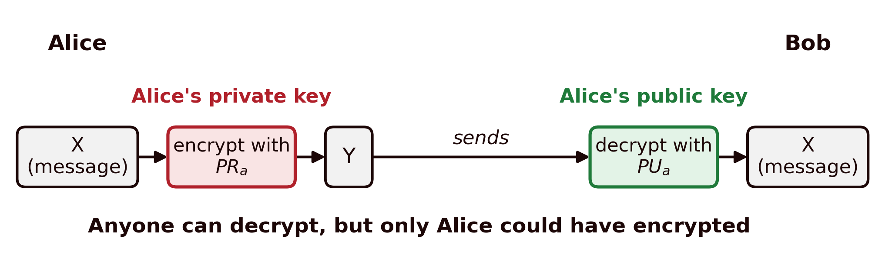
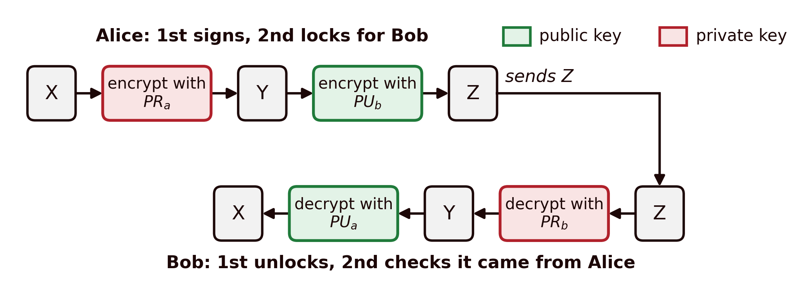
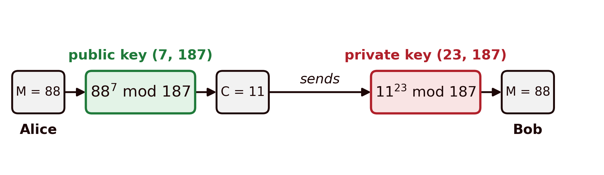
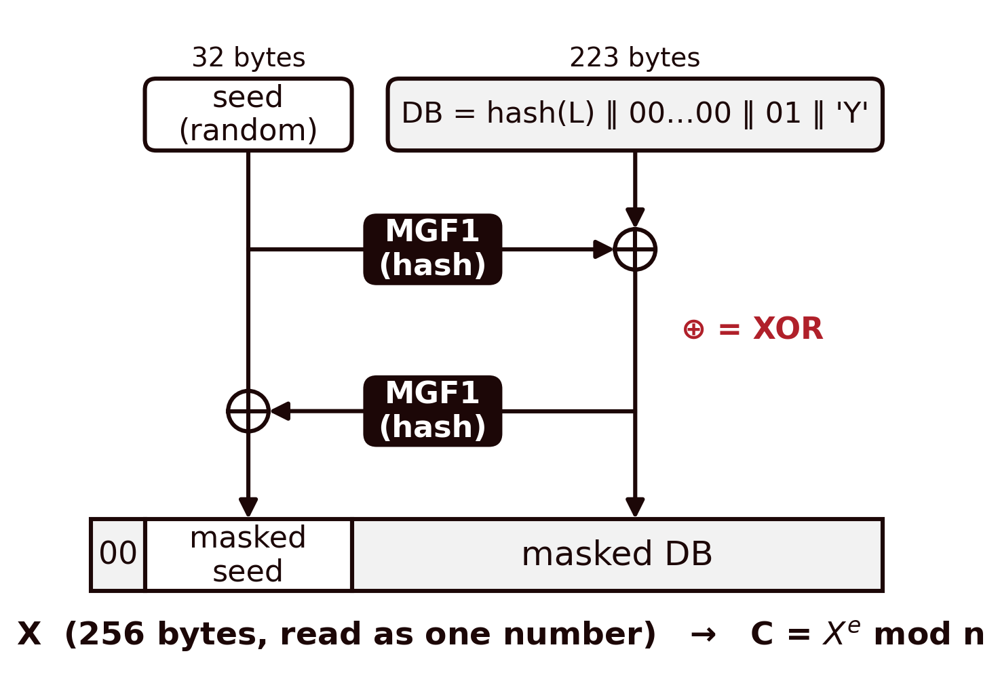
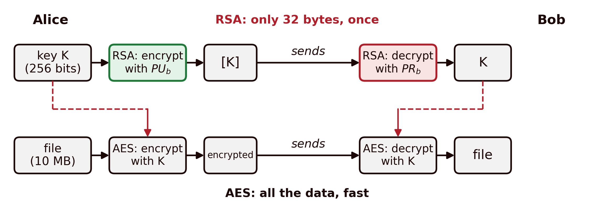

## Introduction {#sec-06-intro .unnumbered}

Symmetric ciphers, from the classical ciphers to AES, and HMAC as well, share a structural limitation: they require a secret key **shared in advance** between sender and receiver. Suppose Alice wants to send Bob, in another city, a file encrypted with AES:

1. AES needs a key $K$ known to **both** of them.
2. If Alice sends $K$ over the Internet, unprotected, an attacker (Darth) reads it on the way.
3. To encrypt $K$, Alice would need another key, already agreed with Bob, and the problem repeats itself.
4. Meeting in person does not scale: in a company with 1000 people, each pair needs its own key, that is, $1000 \times 999 / 2 = 499\,500$ keys.

This is the **key distribution problem**, and for decades it had no satisfactory answer. The solution, proposed by Diffie and Hellman in 1976 and made concrete by Rivest, Shamir and Adleman in 1977 with the algorithm that gives this chapter its name, is radical: instead of a shared key, each participant now has **two mathematically related keys**, one that can be freely disclosed and another that is never revealed to anyone.

## Asymmetric Cryptography: the Concept {#sec-06-conceito}

An analogy helps to grasp the idea. Bob buys many identical padlocks and hands them out **open** to anyone who asks, but keeps to himself the key that opens them. Alice puts the message in a box and locks it with one of Bob's padlocks: locking only takes a push, no key is needed. Once locked, not even Alice can open the box; only Bob can.

In asymmetric cryptography, the open padlock is the **public key** ($PU$), which is disclosed to everyone, and the padlock's key is the **private key** ($PR$), which never leaves its owner. A public-key system rests on six components [@Stallings2020]:

| Component | Role |
|---|---|
| Plaintext $X$ | the original message |
| Encryption algorithm $E$ | transforms $X$ using one of the keys |
| Ciphertext $Y$ | what travels over the network |
| Decryption algorithm $D$ | recovers $X$ using the other key |
| Public key $PU$ | known to everyone |
| Private key $PR$ | known only to its owner |

: The six components of a public-key system {#tbl-06-componentes}

The property that makes this useful is purely mathematical: whatever is encrypted with one key of a pair can only be decrypted with the other, never with the same one. In the notation used below, $PU_b$ and $PR_b$ are Bob's keys, and $PU_a$ and $PR_a$ are Alice's. Choosing which key to use for what gives rise to two distinct schemes, with opposite purposes.

**Confidentiality.** To send Bob a confidential message, Alice encrypts it with **Bob's public key** ($PU_b$), which anyone knows:

$$Y = E[PU_b, X] \qquad X = D[PR_b, Y]$$

{#fig-06-confidencialidade width=100%}

Only Bob can decrypt $Y$, because only he has $PR_b$. Darth also knows $PU_b$, but cannot undo the encryption with it. This solves exactly the problem identified in the introduction: Alice never needed to agree on any secret with Bob, she only needed to know a key that is in plain sight.

**Authentication.** To prove that a message really comes from Alice, the keys swap roles: she encrypts it with her own **private key** ($PR_a$):

$$Y = E[PR_a, X] \qquad X = D[PU_a, Y]$$

{#fig-06-autenticacao width=100%}

Anyone can decrypt $Y$ with Alice's public key, $PU_a$, which is also freely known, and that is precisely why this scheme provides no confidentiality at all. What it provides is a guarantee of who sent it: if $PU_a$ decrypts $Y$, then $Y$ was produced with $PR_a$, and only Alice has it. This is the idea behind the **digital signature**.

**Both at once.** Nothing prevents combining the two schemes. Alice first encrypts with her own private key (signs) and then encrypts the result with Bob's public key (ensures confidentiality):

$$Z = E[PU_b,\, E[PR_a, X]] \qquad X = D[PU_a,\, D[PR_b, Z]]$$

{#fig-06-combinado width=100%}

Only Bob can open $Z$, and inside it he finds a $Y$ that only Alice could have produced: he is certain the message came from Alice and has the guarantee that nobody else read it on the way.

## Categories and Applications {#sec-06-categorias}

Public-key algorithms have three possible uses:

- **Encryption and decryption**, to obtain confidentiality;
- **Digital signature**, to prove who produced a message;
- **Key exchange**, so that both parties end up sharing a secret key (for example, an AES key).

Not every algorithm serves all three:

| Algorithm | Encryption/Decryption | Digital Signature | Key Exchange |
|---|:---:|:---:|:---:|
| RSA | Yes | Yes | Yes |
| Elliptic Curve | Yes | Yes | Yes |
| Diffie-Hellman | No | No | Yes |
| DSS | No | Yes | No |

: Applications of the main public-key algorithms [@Stallings2020] {#tbl-06-aplicacoes}

RSA, presented in this chapter, is, alongside elliptic-curve cryptography, able to serve all three roles. Diffie-Hellman serves only to agree on a shared key; DSS exists only to sign.

## The Mathematics Needed {#sec-06-matematica}

RSA uses only three arithmetic ideas, presented here before the algorithm.

**The remainder of a division.** $a \bmod n$ is the **remainder** of the integer division of $a$ by $n$. A clock does this: 14 hours is 2 in the afternoon, because $14 \bmod 12 = 2$. Likewise, $200 \bmod 187 = 13$, because $200 = 1 \times 187 + 13$, and $161 \bmod 160 = 1$, because $161 = 1 \times 160 + 1$. An important consequence: the result of "$\bmod\ n$" is **always between $0$ and $n-1$**, however large the starting number.

**Primes and coprime numbers.** A **prime number** is divisible only by 1 and by itself (2, 3, 5, 7, 11, 13, 17, ...). The **greatest common divisor**, $\gcd(a, b)$, is the largest number that divides both $a$ and $b$, and $a$ and $b$ are said to be **coprime** when $\gcd(a, b) = 1$, that is, when they share no factor:

| Pair | Factors | gcd | Coprime? |
|---|---|:---:|:---:|
| 6 and 160 | $6 = 2 \times 3$; $160 = 2^5 \times 5$ | 2 | No |
| 7 and 160 | $7$ is prime and does not divide 160 | 1 | Yes |

: Examples of coprime and non-coprime pairs {#tbl-06-coprimos}

**The modular inverse.** In ordinary arithmetic, the inverse of 3 is $\frac{1}{3}$, because $3 \times \frac{1}{3} = 1$. In arithmetic modulo 160 there are no fractions: the **inverse of 7 modulo 160** is the integer $d$ such that

$$7 \times d \bmod 160 = 1$$

One therefore looks for a multiple of 7 that lies one unit above a multiple of 160:

| $d$ | 1 | 2 | ... | 22 | 23 |
|---|:---:|:---:|:---:|:---:|:---:|
| $7 \times d$ | 7 | 14 | ... | 154 | 161 |
| $7 \times d \bmod 160$ | 7 | 14 | ... | 154 | **1** |

: Searching for the inverse of 7 modulo 160 {#tbl-06-inverso}

The inverse of 7 modulo 160 is 23. This inverse only exists because 7 and 160 are coprime: with 6, which shares the factor 2 with 160, the products $6 \times d$ are always even, and an even number minus a multiple of 160 never gives 1.

## RSA: Key Generation {#sec-06-rsa-geracao}

**RSA** (Rivest, Shamir and Adleman, 1977) remains the most widely used public-key algorithm in practice. Generating the key pair takes five steps:

1. Choose two large random prime numbers, $p$ and $q$.
2. Compute the **modulus** $n = p \times q$, which will be public.
3. Compute $\phi(n) = (p-1)(q-1)$, which must be kept secret.
4. Choose $e$, coprime with $\phi(n)$, with $1 < e < \phi(n)$.
5. Compute $d$, the **inverse** of $e$ modulo $\phi(n)$: $e \times d \bmod \phi(n) = 1$.

The **public key** is the pair $(e, n)$; the **private key** is the pair $(d, n)$. The modulus $n$ is public, but $p$, $q$ and $\phi(n)$ are never disclosed: whoever knows them can compute $d$.

A complete example, with small numbers only so that the arithmetic can be done by hand:

1. $p = 17$ and $q = 11$.
2. $n = 17 \times 11 = 187$.
3. $\phi(n) = 16 \times 10 = 160$.
4. $e = 7$, because $\gcd(7, 160) = 1$.
5. $d = 23$, because $7 \times 23 = 161$ and $161 \bmod 160 = 1$ (@tbl-06-inverso).

Bob's public key is $(7, 187)$ and his private key is $(23, 187)$.

## RSA: Encryption and Decryption {#sec-06-rsa-cifra}

In RSA, the message is a **number** $M$, between $0$ and $n-1$; a text is converted into numbers, for example through the codes of its characters. Encrypting and decrypting come down to modular exponentiation:

$$C = M^e \bmod n \qquad\qquad M = C^d \bmod n$$

{#fig-06-exemplo-88 width=100%}

In the example, Alice encrypts $M = 88$ with Bob's public key, $C = 88^7 \bmod 187 = 11$, and Bob decrypts with his private key, $M = 11^{23} \bmod 187 = 88$.

### Computing the Powers by Hand {#sec-06-quadrados}

$88^7 = 40\,867\,559\,636\,992$ is already a large number, and with exponents hundreds of digits long a direct computation would be impossible. The trick is to **reduce modulo $n$ at every step**:

1. Split the exponent into powers of 2: $7 = 4 + 2 + 1$, so $88^7 = 88^4 \times 88^2 \times 88^1$.
2. $88^1 \bmod 187 = 88$.
3. $88^2 = 7744$, and $7744 \bmod 187 = 77$.
4. $88^4 = (88^2)^2$, so it is enough to compute $77^2 = 5929$, and $5929 \bmod 187 = 132$.
5. Multiply everything: $132 \times 77 \times 88 = 894\,432$, and $894\,432 \bmod 187 = 11$.

The intermediate numbers never go much beyond $187^2$. This is how computers do it, even with an $n$ thousands of bits long, and the method is called **square-and-multiply** (exponentiation by repeated squaring).

To decrypt, Bob does the same with the exponent $d = 23 = 16 + 4 + 2 + 1$, always squaring the previous result:

| Power | $11^1$ | $11^2$ | $11^4$ | $11^8$ | $11^{16}$ |
|---|:---:|:---:|:---:|:---:|:---:|
| $\bmod 187$ | **11** | **121** | **55** | 33 | **154** |

: Repeated squares of 11 modulo 187 {#tbl-06-quadrados}

$$11^{23} = 11^{16} \times 11^4 \times 11^2 \times 11^1 \;\rightarrow\; 154 \times 55 \times 121 \times 11 = 11\,273\,570, \qquad 11\,273\,570 \bmod 187 = 88$$

Bob has recovered Alice's message.

### Why Does It Come Back to 88? {#sec-06-porque}

Encrypting and then decrypting means raising to $e$ and then to $d$:

$$(M^e)^d = M^{e \times d} = M^{161}$$

$e$ and $d$ were chosen so that $e \times d = 161 = 160 + 1$, that is, $e \times d \bmod \phi(n) = 1$. With $n = 187$, raising to 161 always returns the starting number, $M^{161} \bmod 187 = M$:

| $M$ | 2 | 5 | 88 |
|---|:---:|:---:|:---:|
| $C = M^7 \bmod 187$ | 128 | 146 | 11 |
| $C^{23} \bmod 187$ | 2 | 5 | 88 |

: Encrypting with $e = 7$ and decrypting with $d = 23$ returns the original message {#tbl-06-volta}

The property holds for every $M$ from 0 to 186. The general proof comes from number theory (Euler's theorem) [@Stallings2020].

## Security: Factoring $n$ {#sec-06-rsa-seguranca}

In the example, Darth knows the public key, $e = 7$ and $n = 187$, the RSA algorithm and the ciphertext $C = 11$. He does not know $d = 23$, nor $p = 17$ and $q = 11$, nor $\phi(n) = 160$. The chain of dependencies is as follows: to compute $d$, he needs $\phi(n)$; to compute $\phi(n) = (p-1)(q-1)$, he needs $p$ and $q$; and to obtain $p$ and $q$, he has to **factor** $n$, that is, find out which primes, multiplied together, give 187.

With $n = 187$, the attack is immediate. Darth divides 187 by each prime, in order:

1. $187 \div 2$, $187 \div 3$, $187 \div 5$ and $187 \div 7$: no division is exact.
2. $187 \div 11 = 17$: he has found $p = 17$ and $q = 11$.
3. He computes $\phi(n) = 16 \times 10 = 160$.
4. He computes the inverse of $e = 7$ modulo 160: $d = 23$.
5. He decrypts everything sent to Bob: $11^{23} \bmod 187 = 88$.

It is enough to try primes up to $\sqrt{187} \approx 13.7$, because if both factors were larger than that, their product would exceed 187. That is at most six divisions (2, 3, 5, 7, 11 and 13). Any 8-bit $n$ (smaller than 256) falls this way: the security is nil.

In practice, $n$ has **2048 to 4096 bits**, a number with 617 to 1234 digits. The primes up to $\sqrt{n}$ number more than $10^{305}$, and trying them one by one is impossible. Multiplying $p \times q$ is instantaneous, but undoing the multiplication has no known fast method: this is the **integer factorisation problem**, on which the whole security of RSA rests.

This does not mean that factoring can only be done by trial division. In 1991, the company RSA Laboratories published a list of moduli as a public challenge, with names of the form RSA-*number of digits*. The current record is **RSA-250**, with 250 digits (829 bits), factored in 2020: a single processor would have needed about 2700 years, and spread over thousands of computers it took a few months. The best known method, the *General Number Field Sieve* (GNFS), has **subexponential** complexity: it grows more slowly than an exhaustive search, but faster than a polynomial algorithm [@Stallings2020]. It is the existence of this shortcut, much faster than trial division, that forces RSA to use keys far larger than those of a symmetric cipher for the same security level:

| Equivalent security (bits) | 112 (3DES) | 128 | 192 | 256 |
|---|:---:|:---:|:---:|:---:|
| Equivalent RSA modulus (bits) | 2048 | 3072 | 7680 | 15 360 |

: RSA modulus size for each security level [@NIST80057] {#tbl-06-tamanhos}

## A Real RSA Key {#sec-06-chave-real}

`openssl` generates and displays a 2048-bit RSA key pair:

```bash
$ openssl genpkey -algorithm RSA -pkeyopt rsa_keygen_bits:2048 -out bob.pem
$ openssl pkey -in bob.pem -text -noout
Private-Key: (2048 bit, 2 primes)
modulus:
    00:da:2c:3c:33:c6:c3:1a:7d:7a:e2:cc:af:74:48: ...
publicExponent: 65537 (0x10001)
privateExponent:
    61:44:4b:6a:c1:f8:85:bc:df:a6:71:9e:df:76:fa: ...
prime1:
    00:ee:f1:6c:4f:11:2f:fd:f9:8e:ba:17:29:c6:93: ...
prime2:
    00:e9:bf:3e:ad:10:df:07:59:b3:ff:48:88:88:b0: ...
```

| Command or field | Meaning |
|---|---|
| `genpkey -algorithm RSA` | generates a new RSA key pair |
| `-pkeyopt rsa_keygen_bits:2048` | with a 2048-bit modulus $n$ |
| `-out bob.pem` | saves the private key (which includes the public one) to `bob.pem` |
| `pkey -in bob.pem -text -noout` | displays the numbers of the key as text |
| `modulus`, `publicExponent`, `privateExponent`, `prime1`, `prime2` | $n$, $e$, $d$, $p$ and $q$ |

: Commands and fields in the example {#tbl-06-openssl-chave}

The values are in **hexadecimal**: each pair of characters is one byte, and the ":" only separate the bytes for readability; the leading `00` merely indicates that the number is positive. Read as a whole, the `modulus` is a single 2048-bit integer, which in decimal would have 617 digits. `prime1` and `prime2` are $p$ and $q$: whoever has them can compute $d$, which is why the private key file is **never** shared.

The public exponent is $e = 65\,537$ in almost every key in the world. $e$ is fixed first, and only primes $p$ and $q$ for which $p-1$ and $q-1$ are not multiples of 65 537 are accepted, so that $e$ is coprime with $\phi(n)$. About one prime in every 65 536 fails, and it is simply replaced by another.

## Textbook RSA and RSA-OAEP {#sec-06-oaep}

Using RSA exactly as described, so-called **textbook RSA**, has a problem: $C = M^e \bmod n$ **always** gives the same $C$ for the same $M$. Consider a vote encrypted with Bob's public key, $(7, 187)$:

1. Alice votes "Y" (code 89) or "N" (code 78) and sends $C$ to Bob.
2. Darth intercepts $C = 166$.
3. Darth also has the public key: he computes $89^7 \bmod 187 = 166$ and $78^7 \bmod 187 = 56$.
4. He compares: $166 = 166$, Alice voted "Y".

Darth factored nothing, did not find $d$, and still read the message. When there are few possible messages, encrypting each of them with the public key and comparing is enough. That is why no serious cryptographic library uses RSA this way.

The solution is to add randomness before encrypting. In **RSA-OAEP** (*Optimal Asymmetric Encryption Padding*), the message is hidden by an **XOR** with bytes that depend on a random value. With a 2048-bit key and SHA-256:

1. Alice generates 32 fresh random bytes, the **seed**, for this message only.
2. She prepares the **DB** block (223 bytes): the vote, preceded by padding (the hash of a label $L$, usually empty, 00 bytes and a 01 byte marking the start of the message).
3. She applies the hash to the seed repeatedly (the **MGF1** function) until she has 223 bytes, the **mask**, and computes the XOR: masked DB = DB $\oplus$ mask.
4. She also hides the seed, with an XOR against a mask computed in the same way from the masked DB.
5. She concatenates 00, the masked seed and the masked DB: 256 bytes, read as a single number $X$, which is encrypted with ordinary RSA, $C = X^e \bmod n$.

{#fig-06-oaep width=80%}

To decrypt, Bob undoes these steps in reverse order:

1. He computes $X = C^d \bmod n$ and splits it at fixed positions: the 00 byte, the masked seed (32 bytes) and the masked DB (223 bytes).
2. He recovers the seed: MGF1 applied to the masked DB gives the seed mask, and seed = masked seed $\oplus$ mask.
3. He recovers the DB: MGF1 applied to the seed gives the DB mask, and DB = masked DB $\oplus$ mask.
4. He checks the padding: the DB must start with the hash of $L$, followed by 00 bytes and a 01 byte, and the first byte of $X$ must be 00. If everything checks out, whatever follows the 01 is the message; otherwise, he rejects it.

This works because XOR cancels itself out, $(a \oplus m) \oplus m = a$, and because MGF1 has no secret at all: with the same input, Bob obtains exactly the same masks as Alice. The order is mandatory, because the DB mask can only be computed once the seed has been recovered. The two XORs protect nothing on their own: anyone holding $X$ could undo them in the same way. What stops Darth from reaching $X$ is the RSA layer, because only Bob has $d$.

The label $L$ does not travel inside $C$: it is agreed beforehand between Alice and Bob, as part of the protocol they use, and it is almost always empty. Bob does not read it from the message; he computes the hash of the $L$ he expects and compares it with the first 32 bytes of the DB. The label serves to bind the ciphertext to a context: with $L$ = "Student Union Election 2026", a $C$ reused in another vote, with another label, is rejected, even though the RSA decryption itself succeeds. Even with an empty $L$, those 32 fixed bytes act as a known marker, which a forged or corrupted $C$ will practically never hit by chance. In `openssl`, the label is set with `-pkeyopt rsa_oaep_label:` followed by its value in hexadecimal, both when encrypting and when decrypting.

Because the seed is new for every encryption, so are the masks, and $X$ and $C$ come out completely different each time. Darth can encrypt "Y" and "N" as often as he likes and will never obtain Alice's $C$. For **signatures**, the corresponding scheme is called **RSA-PSS** (*Probabilistic Signature Scheme*).

`openssl` shows the effect: the same file `vote.txt`, containing only "Y", encrypted twice with OAEP, gives two results with nothing in common:

```bash
$ openssl pkey -in bob.pem -pubout -out bob_pub.pem
$ openssl pkeyutl -encrypt -pubin -inkey bob_pub.pem \
      -pkeyopt rsa_padding_mode:oaep -pkeyopt rsa_oaep_md:sha256 \
      -in vote.txt | xxd -p | head -c 48
b0947d10a7c616e31e3c30b5b355d6ca91030e53ab074c63
$ openssl pkeyutl -encrypt -pubin -inkey bob_pub.pem \
      -pkeyopt rsa_padding_mode:oaep -pkeyopt rsa_oaep_md:sha256 \
      -in vote.txt | xxd -p | head -c 48
beef35280c44cfc8e078ab789e656c07cedd86565b1ca79e
```

| Command or option | Meaning |
|---|---|
| `pkey -in bob.pem -pubout` | extracts only the public part, $(e, n)$, from the private key file and saves it to `bob_pub.pem` |
| `pkeyutl -encrypt` | encrypts a file with a key |
| `-pubin -inkey bob_pub.pem` | the key to use is public and is in `bob_pub.pem` |
| `-pkeyopt rsa_padding_mode:oaep` | applies OAEP before encrypting |
| `-pkeyopt rsa_oaep_md:sha256` | OAEP uses SHA-256 (without this option, `openssl` uses SHA-1) |
| `-in vote.txt` | the file to encrypt |
| `xxd -p` \| `head -c 48` | shows the result in hexadecimal, only the first 24 of the 256 bytes |
| `\` at the end of a line | the command continues on the next line |

: Commands and options in the OAEP example {#tbl-06-openssl-oaep}

## In Practice: RSA Carries the AES Key {#sec-06-hibrido}

RSA is **much slower** than AES, and each block has to be a number smaller than $n$: with 2048 bits, under 256 bytes. That is why, in practice, RSA encrypts **only the AES key $K$**, once, and the data is encrypted with AES:

{#fig-06-hibrido width=100%}

This is the answer to the problem in the introduction: Alice generates a random key $K$, sends it to Bob encrypted with his public key, and from then on both use the fast symmetric cipher, with a key that never travelled in the clear.

## Chapter Summary {#sec-06-sintese}

1. Each participant has a **public key**, disclosed, and a **private key**, secret; whatever one encrypts, only the other decrypts
2. Encrypting with the **recipient's** public key gives confidentiality; encrypting with one's **own** private key proves who sent it; combining both gives both
3. RSA and elliptic curves serve to encrypt, sign and exchange keys; Diffie-Hellman only to exchange keys, and DSS only to sign
4. **RSA**: $n = p \times q$, $e$ coprime with $\phi(n) = (p-1)(q-1)$, $d$ the inverse of $e$ modulo $\phi(n)$; $C = M^e \bmod n$ and $M = C^d \bmod n$, computed by square-and-multiply
5. Security depends on it being impractical to **factor** $n$; with $n = 187$ six divisions are enough, which is why in practice $n$ has 2048 to 4096 bits
6. Textbook RSA is deterministic: **RSA-OAEP** is used to encrypt and **RSA-PSS** to sign
7. In practice, RSA encrypts an AES key, and AES encrypts the data

## Food for Thought {#sec-06-reflexao}

The public exponent $e = 65\,537$ is the same in millions of different RSA keys, without compromising any of them. In this chapter's example ($n = 187$), if Bob replaced $e = 7$ with a much larger $e$, keeping the same $n$, would the key become more secure? Why?

## References {#sec-06-referencias .unnumbered}

::: {#refs}
:::
