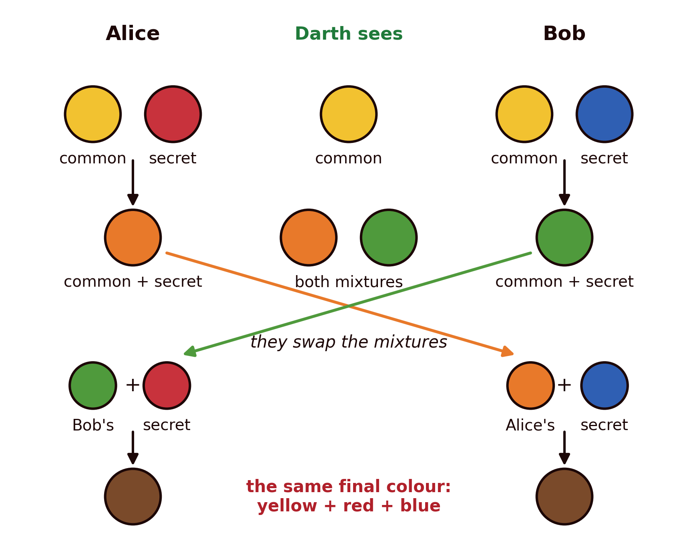
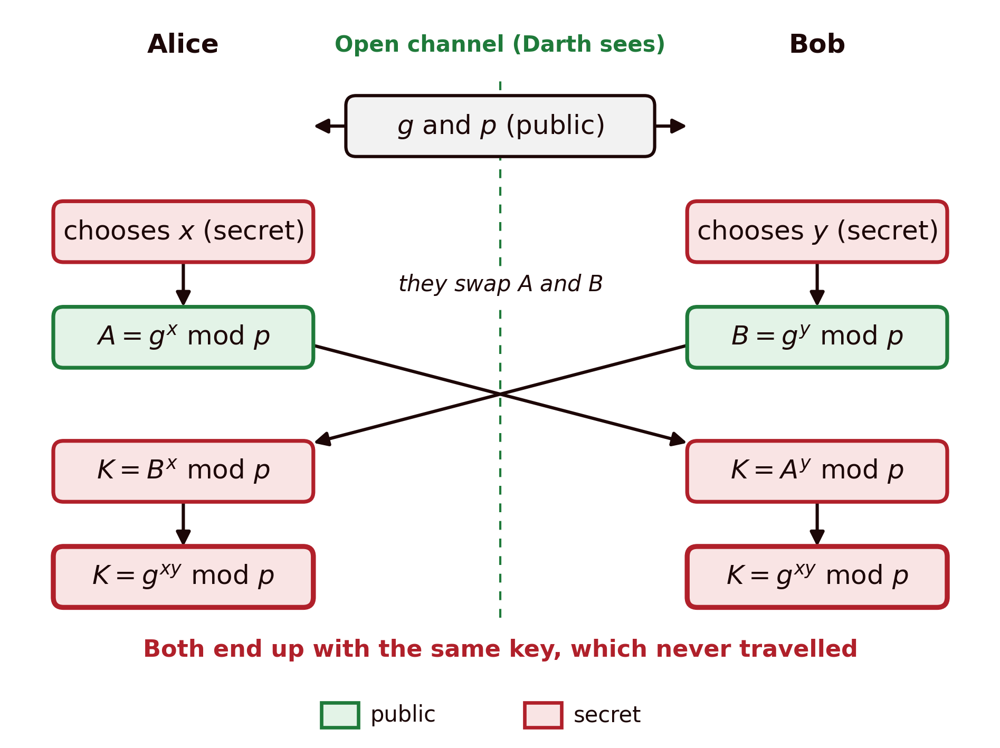
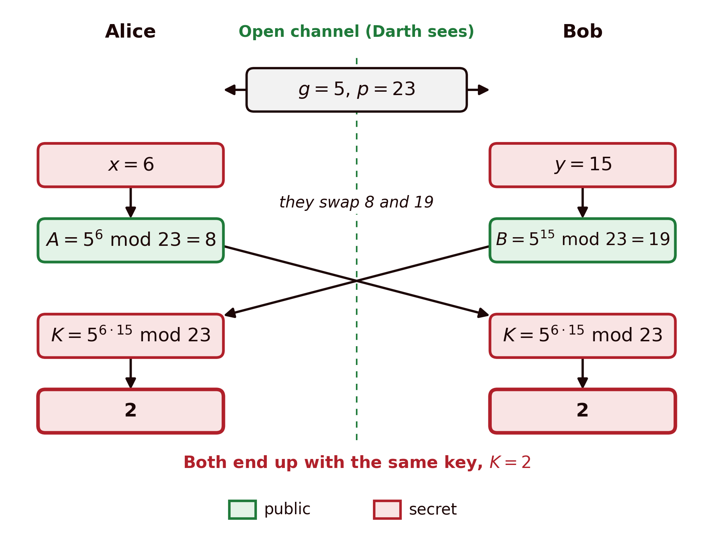
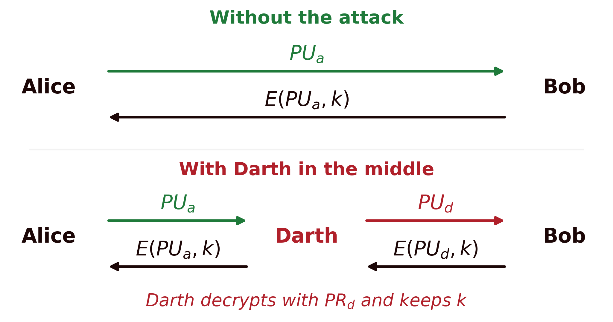
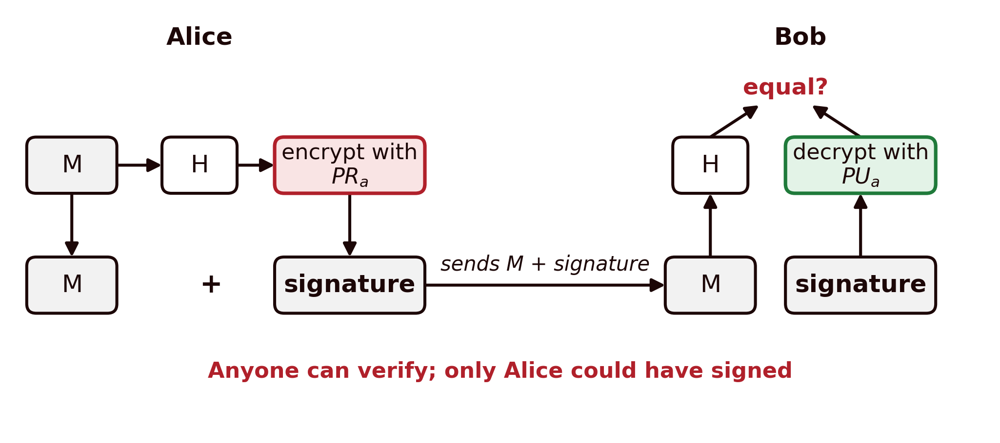
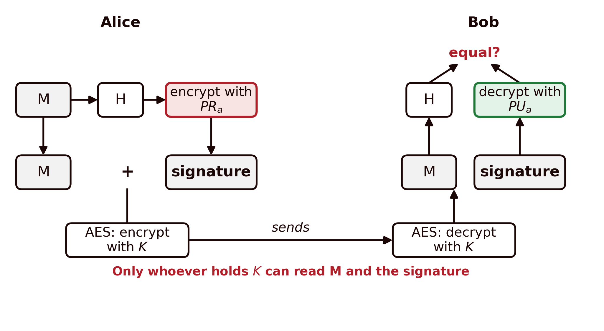
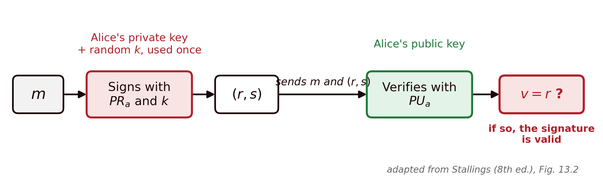
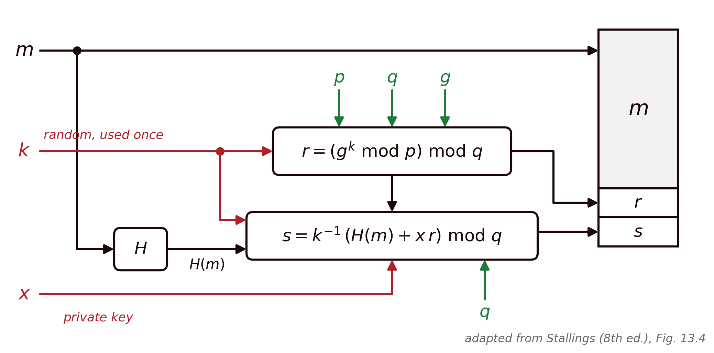
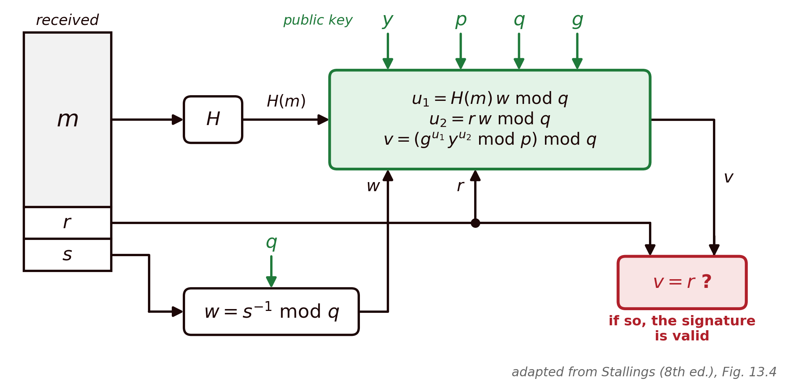
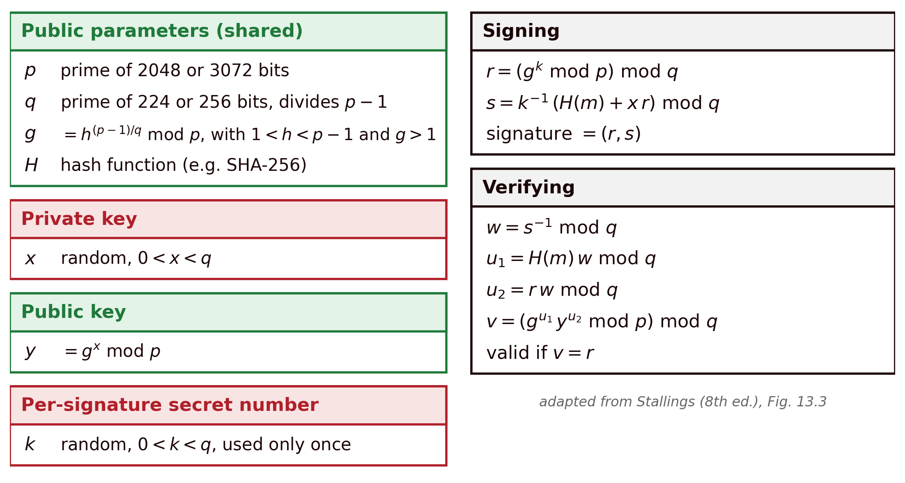

## Introduction {#sec-07-intro .unnumbered}

With RSA, Alice generates a key $K$ for AES and sends it to Bob, encrypted with his public key. It works, but $K$ **travels** over the network, even if encrypted. This chapter deals with two different problems that public-key cryptography solves. The first is agreeing on a secret key between two people without that key ever being sent: this is what **Diffie-Hellman** does. The second is proving, in a way anyone can check, who wrote a message, without the author being able to deny it later: this is the role of **digital signatures**, with RSA and with **DSA**.

## Agreeing on a Key Without Sending It {#sec-07-dh-conceito}

**Diffie-Hellman** (1976) works like this:

1. Alice and Bob exchange messages in plain view.
2. At the end, both compute **the same number** $K$.
3. $K$ is never sent: Darth sees everything that goes by and still cannot compute it.
4. $K$ is then used as the key for a symmetric cipher, such as AES.

It is a **key-exchange** method: it does not encrypt messages, nor does it sign them.

The idea can be grasped with paint. Alice and Bob agree in public on a common colour, yellow. Each secretly picks a colour of their own, mixes it with the yellow and sends the mixture to the other. Finally, each adds their own secret colour to the mixture received, and both end up with the same final colour, made of yellow and the two secret colours.

{#fig-07-tintas width=90%}

Mixing paint is easy; **separating** a mixture into its original colours is practically impossible. Darth sees the yellow and both mixtures, but cannot make the final colour, because for that he would need one of the secret colours.

## The Mathematics Needed {#sec-07-dh-matematica}

In mathematics, the role of the "mixture" is played by a **power modulo a prime** $p$. With $p = 23$ and $g = 5$:

| $x$ | 1 | 2 | 3 | 4 | 5 | 6 | 7 | 8 | 9 | 10 | 11 |
|---|:---:|:---:|:---:|:---:|:---:|:---:|:---:|:---:|:---:|:---:|:---:|
| $5^x \bmod 23$ | 5 | 2 | 10 | 4 | 20 | **8** | 17 | 16 | 11 | 9 | 22 |
| $x$ | **12** | **13** | **14** | **15** | **16** | **17** | **18** | **19** | **20** | **21** | **22** |
| $5^x \bmod 23$ | 18 | 21 | 13 | **19** | 3 | 15 | 6 | 7 | 12 | 14 | 1 |

: Powers of 5 modulo 23 {#tbl-07-potencias}

The results jump around irregularly, with no apparent order. 5 is a **generator**: its powers go through **all** the values from 1 to 22 before repeating. Not every number has this property: the powers of 2, for instance, give only 11 different values.

**Without a modulus**, undoing a power is easy. If $5^x = 390\,625$, since $5^x$ always grows, it is enough to climb up to it: $5^8 = 390\,625$, so $x = 8$. That is the logarithm, $x = \log_5 390\,625$.

**With a modulus**, the order disappears. If $5^x \bmod 23 = 8$, the 8 is not "close" to any known value, and the only direct way to find $x$ is to try $x = 1, 2, 3, \ldots$ until it matches ($x = 6$).

| Direction | Operation | Cost |
|---|---|---|
| Forward | given $x$, compute $g^x \bmod p$ | easy (repeated squaring) |
| Backward | given $g^x \bmod p$, find $x$ | **infeasible** with a large $p$ |

: The two directions of the power modulo a prime {#tbl-07-sentidos}

The backward direction is called the **discrete logarithm problem**, and the security of Diffie-Hellman rests on it.

## The Diffie-Hellman Algorithm {#sec-07-dh-algoritmo}

{#fig-07-dh width=80%}

1. A prime $p$ and a generator $g$ are agreed in public.
2. Alice picks a secret $x$; Bob, a secret $y$.
3. They exchange, in the clear, $A = g^x \bmod p$ and $B = g^y \bmod p$: these are each one's **public keys**.
4. Each raises the value received to **their own** secret and obtains the same $K$: Alice computes $B^x \bmod p$ and Bob $A^y \bmod p$.

With the numbers in @tbl-07-potencias, Alice picks $x = 6$ and Bob $y = 15$:

{#fig-07-dh-exemplo width=80%}

The 8 and the 19 can be read straight from the table. Alice computes $19^6 \bmod 23$ and Bob $8^{15} \bmod 23$, by repeated squaring, and both get **2**.

They reach the same number because raising a power to another power multiplies the exponents, and the order of the multiplication does not matter:

$$\text{Alice: } B^x = (g^y)^x = g^{yx} \qquad\qquad \text{Bob: } A^y = (g^x)^y = g^{xy}$$

In the example, $(5^{15})^6 = 5^{90}$ and $(5^6)^{15} = 5^{90}$, and reducing modulo 23 along the way does not change the final result. Since the powers of 5 repeat every 22 steps, the exponent 90 gives the same as $90 \bmod 22 = 2$, and $5^2 \bmod 23 = 2$. The common result is

$$K = g^{xy} \bmod p$$

Alice never knew $y$, Bob never knew $x$, and $K$ never went over the network.

## Security of Diffie-Hellman {#sec-07-dh-seguranca}

| Darth knows | Darth does not know |
|---|---|
| $p = 23$ and $g = 5$ | $x = 6$ |
| $A = 8$ and $B = 19$ | $y = 15$ |
| the algorithm | $K = 2$ |

: What Darth sees and what he lacks in the example {#tbl-07-darth}

$A$ and $B$ are not enough: multiplying them or raising one to the other does not give $K$. Darth needs $x$ or $y$. With $p = 23$, the attack is immediate:

1. He tries $5^1, 5^2, 5^3, \ldots \bmod 23$ until he gets $A = 8$, and finds $x = 6$ on the sixth attempt.
2. He computes $K = B^x = 19^6 \bmod 23 = 2$, just like Alice.

That is at most 22 attempts: the security is nil. In practice, $p$ has **2048 bits** or more, and there are far too many exponents to try one by one. But, as with factoring in RSA, there is a shortcut: a variant of the General Number Field Sieve (GNFS) solves the discrete logarithm in **subexponential** time, much faster than trying every exponent [@Stallings2020]. That is why Diffie-Hellman needs numbers as large as RSA's for the same security:

| Equivalent security (bits) | 112 (3DES) | 128 | 192 | 256 |
|---|:---:|:---:|:---:|:---:|
| Diffie-Hellman prime $p$ (bits) | 2048 | 3072 | 7680 | 15 360 |

: Size of the prime $p$ for each security level [@NIST80057] {#tbl-07-tamanhos}

$p$ and $g$ do not need to be generated afresh for each exchange: **standard groups** are used, published for everyone to use. The `ffdhe2048` group, for instance, has a 2048-bit $p$ and $g = 2$.

## Diffie-Hellman in `openssl` {#sec-07-dh-openssl}

`openssl` performs the complete exchange with the `ffdhe2048` group:

```bash
$ openssl genpkey -algorithm DH -pkeyopt group:ffdhe2048 -out alice.pem
$ openssl genpkey -algorithm DH -pkeyopt group:ffdhe2048 -out bob.pem
$ openssl pkey -in alice.pem -pubout -out alice_pub.pem
$ openssl pkey -in bob.pem -pubout -out bob_pub.pem
$ openssl pkeyutl -derive -inkey alice.pem -peerkey bob_pub.pem | xxd -p | head -c 48
e0d709b889817a241db4f4c6116533e746119833b3128ca3
$ openssl pkeyutl -derive -inkey bob.pem -peerkey alice_pub.pem | xxd -p | head -c 48
e0d709b889817a241db4f4c6116533e746119833b3128ca3
```

| Command or option | Meaning |
|---|---|
| `genpkey -algorithm DH -pkeyopt group:ffdhe2048` | picks a secret ($x$ or $y$) and computes the public key ($A$ or $B$) with the $p$ and $g$ of the `ffdhe2048` group |
| `-out alice.pem` | saves the secret and the public key in `alice.pem` |
| `pkey -in alice.pem -pubout -out alice_pub.pem` | saves the public key on its own, the part sent to the other side |
| `pkeyutl -derive -inkey alice.pem -peerkey bob_pub.pem` | Alice computes $K = B^x \bmod p$ with her secret and Bob's public key |
| `xxd -p` \| `head -c 48` | shows $K$ in hexadecimal, only the first 24 of its 256 bytes |

: Commands and options in the Diffie-Hellman example {#tbl-07-openssl-dh}

The two `-derive` commands give the **same** $K$, each on its own side, without $K$ having been sent.

## The Man-in-the-Middle Attack {#sec-07-mitm}

Any exchange of public keys has a weakness, which shows clearly in a simple case: Alice sends Bob her public key $PU_a$, and Bob generates a key $k$ for AES and returns it encrypted, $E(PU_a, k)$.

{#fig-07-mitm width=85%}

Darth, somewhere on the network between them (for example, a compromised router), intercepts $PU_a$ and hands Bob his own public key, $PU_d$, instead. Bob, unaware, encrypts $k$ with $PU_d$. Darth decrypts it with his private key $PR_d$, keeps $k$, encrypts it again with $PU_a$ and delivers it to Alice. The two carry on communicating, encrypting everything with $k$, without knowing that Darth reads every message.

This is the **man-in-the-middle** (MITM) attack. Against Diffie-Hellman it works the same way: Darth runs one exchange with Alice and another with Bob, ends up with a key agreed with each, and decrypts and re-encrypts everything that passes. The problem is not in the mathematics, which remains intact, but in the fact that neither of them knows **whose** public key they received.

## Digital Signatures: the Concept {#sec-07-assinaturas-conceito}

A digital signature must guarantee three things:

| Property | Question it answers |
|---|---|
| **Authentication** | Who produced the message? |
| **Integrity** | Was the message altered after it was signed? |
| **Non-repudiation** | Can the author deny having signed it? |

: The three properties of a digital signature {#tbl-07-propriedades}

HMAC already provides the first two, but not the third. The HMAC key is **shared**: Alice and Bob can both compute the tag. If Bob shows a judge a message with a valid HMAC, Alice can always say that Bob made it. With a **private key**, only Alice could have signed, and there is no way to deny it.

### Signing the Hash {#sec-07-assinar-hash}

{#fig-07-assinar width=100%}

1. Alice computes the hash of the message, $H(M)$, and encrypts it with her **private** key: that is the signature.
2. She sends $M$ and the signature side by side.
3. Bob computes $H(M)$ over the message he received, decrypts the signature with Alice's **public** key and compares the two values: if they are equal, the signature is valid.

The hash is signed rather than the message because the hash is short, has a fixed size, and RSA is slow.

In this scheme, $M$ travels **in the clear**: anyone can read it. The signature proves who wrote it, but hides nothing. If confidentiality is needed, the whole (message and signature) is encrypted with a symmetric cipher, such as AES, with a key $K$ agreed between the two, for instance with Diffie-Hellman:

{#fig-07-assinar-cifrar width=100%}

### An Example with RSA {#sec-07-assinar-rsa}

Alice has an RSA key pair with small numbers: public $(7, 187)$, private $(23, 187)$. So that the arithmetic can be done by hand, suppose $H(M) = 99$.

1. Alice signs with her private key: $99^{23} \bmod 187 = 176$.
2. She sends $M$ and the signature, 176.
3. Bob computes $H(M) = 99$ over the message received.
4. He decrypts the signature with Alice's public key: $176^{7} \bmod 187 = 99$.
5. $99 = 99$: the signature is valid.

If Darth alters $M$ on the way, the hash changes (to 100, say) and no longer matches 99. To create a new signature for 100, Darth would need $d = 23$, which only Alice has.

In practice, **RSA-PSS** (Probabilistic Signature Scheme) is used, which adds randomness to the hash before signing, for the same reason OAEP does when encrypting: without it, the same message always gives the same signature.

### Signing in `openssl` {#sec-07-assinar-openssl}

The file `order.txt` contains "Transfer 100 euros to Bob". Alice signs it with a 2048-bit RSA key, and Bob checks the signature before and after someone alters the file:

```bash
$ openssl dgst -sha256 -sign alice_rsa.pem -sigopt rsa_padding_mode:pss \
      -out order.sig order.txt
$ openssl dgst -sha256 -verify alice_rsa_pub.pem -sigopt rsa_padding_mode:pss \
      -signature order.sig order.txt
Verified OK
$ echo "Transfer 900 euros to Bob" > order.txt
$ openssl dgst -sha256 -verify alice_rsa_pub.pem -sigopt rsa_padding_mode:pss \
      -signature order.sig order.txt
Verification failure
```

| Command or option | Meaning |
|---|---|
| `dgst -sha256 -sign alice_rsa.pem` | computes the SHA-256 of the file and signs it with Alice's private key |
| `-sigopt rsa_padding_mode:pss` | uses RSA-PSS |
| `-out order.sig order.txt` | saves the signature (256 bytes) in `order.sig`; the signed file is `order.txt` |
| `-verify alice_rsa_pub.pem -signature order.sig` | checks the signature with Alice's public key |
| `echo "..." > order.txt` | alters the file: 100 becomes 900 |
| `\` at the end of a line | the command continues on the next line |

: Commands and options in the signature example {#tbl-07-openssl-assinar}

Changing a single digit is enough for verification to fail: the hash of the altered file no longer matches the one that was signed.

## DSA {#sec-07-dsa}

RSA can both encrypt and sign. **DSA** (Digital Signature Algorithm) was designed only for signing:

- it rests on the same problem as Diffie-Hellman, the **discrete logarithm**;
- it guarantees authentication, integrity and non-repudiation;
- it was standardised in 1994 in the **DSS** (Digital Signature Standard, FIPS 186);
- it uses a new random number for **every** signature, so signing the same message twice gives different signatures.

The current version of the standard, FIPS 186-5 of 2023, no longer approves DSA for creating new signatures, only for verifying old ones [@FIPS1865]. Its structure lives on, however, in the algorithms that replaced it, which is why it is worth understanding.

Seen from a distance, DSA has the same shape as signing with RSA: Alice signs with her private key, and anyone verifies with her public key.

{#fig-07-dsa-simples width=100%}

There are two differences. A random number $k$ comes in, new for every signature, and the signature is a pair of numbers, $(r, s)$. Moreover, verification decrypts nothing: it computes a value $v$ from the message, $(r, s)$ and the public key, and compares it with $r$.

### Signing and Verifying {#sec-07-dsa-assinar}

Inside the "Signs" box, Alice uses the public parameters $p$, $q$ and $g$, her private key $x$ and the random number $k$:

{#fig-07-dsa-assinar width=100%}

$k^{-1}$ is the inverse of $k$ modulo $q$, the number that, multiplied by $k$, gives 1 modulo $q$. $s$ must meet four requirements at once: depend on the message, prove that $x$ was used, reveal neither $x$ nor $k$, and allow verification by someone who knows neither of them.

On the other side, Bob only uses public values: the message, $(r, s)$, $p$, $q$, $g$ and Alice's public key $y$.

{#fig-07-dsa-verificar width=100%}

The computations rebuild $g^k$, and hence $r$, without ever knowing $k$ or $x$. If the message or the signature has been altered, $v$ comes out different from $r$. @fig-07-dsa-tabela gathers all the values and formulas in one place.

{#fig-07-dsa-tabela width=100%}

In practice, $q$ has 224 or 256 bits and $p$ has 2048 or 3072 bits. The two primes are linked: $p - 1$ must be a multiple of $q$. The reason for this link is explained below, in the section on the cycle of $q$ steps.

### An Example with Small Numbers {#sec-07-dsa-exemplo}

The parameters follow the recipe in @fig-07-dsa-tabela: $q = 11$; $p = 23$, because $22 = 2 \times 11$; with $h = 2$, $g = 2^{22/11} \bmod 23 = 2^2 = 4$. Alice picks the private key $x = 5$, which she keeps to herself, and publishes $y = 4^5 \bmod 23 = 12$. Suppose $H(m) = 4$.

**Alice signs** with $k = 8$:

1. $4^8 \bmod 23 = 9$, so $r = 9 \bmod 11 = 9$.
2. $k^{-1} = 7$, because $8 \times 7 = 56$ and $56 \bmod 11 = 1$.
3. $s = 7 \times (4 + 5 \times 9) \bmod 11 = 343 \bmod 11 = 2$.
4. The signature is $(r, s) = (9, 2)$.

**Bob verifies**, using only the public key $y = 12$:

1. $w = 2^{-1} \bmod 11 = 6$, because $2 \times 6 = 12$ and $12 \bmod 11 = 1$.
2. $u_1 = 4 \times 6 \bmod 11 = 2$.
3. $u_2 = 9 \times 6 \bmod 11 = 10$.
4. $4^2 \times 12^{10} \bmod 23 = 16 \times 2 \bmod 23 = 9$.
5. $v = 9 \bmod 11 = 9 = r$: the signature is **valid**.

### Why Verification Works {#sec-07-dsa-porque}

From the formula for $s$, multiplying both sides by $k$ and by $w = s^{-1}$ gives

$$k = w\,(H(m) + x\,r) = u_1 + u_2\,x \pmod q$$

In the example, $u_1 + u_2\,x = 2 + 10 \times 5 = 52$, and $52 \bmod 11 = 8$, which is Alice's $k$. Since $y = g^x$, Bob computes, without knowing $x$ or $k$,

$$g^{u_1} \times y^{u_2} = g^{u_1} \times g^{x\,u_2} = g^{u_1 + x\,u_2} = g^{k} \pmod p$$

and reduces the result modulo $q$, obtaining exactly Alice's $r$. There is a subtlety in this step: the exponent $u_1 + x\,u_2$ was computed modulo $q$, and is not the same number as $k$; it only has the same remainder when divided by $q$. That is enough only because DSA's $g$ was chosen on purpose so that its powers repeat every $q$ steps.

### Why a Cycle of $q$ Steps Is Needed {#sec-07-dsa-ciclo}

With $p = 23$ and $g = 4$, the powers of $g$ repeat after a few steps:

| $i$ | 1 | 2 | 3 | 4 | 5 | 6 | 7 | 8 | 9 | 10 | 11 | 12 | 13 |
|---|:---:|:---:|:---:|:---:|:---:|:---:|:---:|:---:|:---:|:---:|:---:|:---:|:---:|
| $4^i \bmod 23$ | 4 | 16 | 18 | 3 | 12 | 2 | 8 | 9 | 13 | 6 | **1** | 4 | 16 |

: Powers of 4 modulo 23 {#tbl-07-ciclo}

After 11 steps the 1 appears, and from then on everything repeats. In an exponent, only the remainder of the division by 11 then matters: $4^{12} \bmod 23 = 4 = 4^1$, because $12 \bmod 11 = 1$. The length of this cycle is called $q$. With an arbitrary $g$, this fails: the 5 of @tbl-07-potencias repeats only after 22 steps, and $5^{12} \bmod 23 = 18$, whereas $5^1 = 5$. A signature computed with exponents reduced modulo 11 and with $g = 5$ would never be accepted.

DSA needs this cycle for three reasons:

1. **Size and speed.** $p$ must be large, 3072 bits, for the discrete logarithm to be hard. $q$ can be much smaller, 256 bits. Since the signature computations are done modulo $q$, the signature has $2 \times 256 = 512$ bits, instead of $2 \times 3072 = 6144$. And the exponents (the private key and the random number) have 256 bits instead of 3072, which makes each power about 12 times faster.
2. **Divisions.** Signing uses $k^{-1}$ and verifying uses $s^{-1}$. These inverses are computed modulo $q$, and with a prime $q$ every number from 1 to $q - 1$ has an inverse. If the modulus were $p - 1$, which is always even, half the numbers would have no inverse: modulo 22, for example, 4 times any number always gives an even result, never 1.
3. **Security.** If the cycle length has small factors (such as $22 = 2 \times 11$), the discrete logarithm can be attacked in pieces. The Pohlig-Hellman method first finds the remainder of the secret modulo each small factor, which is fast, and then puts the pieces together. With a cycle whose length is a large prime, there are no pieces: the attacker must face the whole cycle of $q$ steps, and with a 256-bit $q$ the best generic methods need about $2^{128}$ operations.

It remains to see why the recipe $g = h^{(p-1)/q} \bmod p$ gives a cycle of exactly $q$ steps:

1. **Fermat's little theorem.** If $p$ is prime, for any $h$ between 2 and $p - 2$, $h^{p-1} \bmod p = 1$. With $h = 2$: $2^{22} \bmod 23 = 1$.
2. **The $q$ disappears.** Raising $g$ to $q$ multiplies the exponents, and dividing by $q$ and multiplying by $q$ cancel out: $g^q = \left(h^{(p-1)/q}\right)^q = h^{p-1}$. In the example, $4^{11} = (2^2)^{11} = 2^{22}$.
3. **The cycle closes.** Hence $g^q \bmod p = 1$, and after $q$ steps the 1 appears: $4^{11} \bmod 23 = 1$, as in @tbl-07-ciclo.
4. **Why $q$ is prime.** The cycle of $g$ must fit a whole number of times into $q$. If $q$ is prime, the cycle can only have $q$ steps, or 1 step when $g = 1$. That is why, if $g = 1$ comes out, another $h$ is chosen.

## Never Reuse $k$ {#sec-07-dsa-k}

The number $k$ must be secret and new for every signature. Suppose Alice signs two messages with the **same** $k = 8$: $H(m_1) = 6$ gives $(9, 5)$ and $H(m_2) = 4$ gives $(9, 2)$. Since $r = (g^k \bmod p) \bmod q$ depends only on $k$, $r$ repeats, and Darth notices:

1. He subtracts the two equations for $s$. The term $x\,r$ is the same in both and disappears:
   $$s_1 - s_2 = k^{-1}\,(H(m_1) - H(m_2)) \bmod q$$
2. He isolates $k$: $k = (H(m_1) - H(m_2)) \times (s_1 - s_2)^{-1} \bmod q$. With the numbers in the example, $6 - 4 = 2$ and $s_1 - s_2 = 3$, whose inverse is 4, because $3 \times 4 = 12$ and $12 \bmod 11 = 1$. So $k = 2 \times 4 \bmod 11 = 8$.
3. He isolates $x$: $x = (s_1\,k - H(m_1)) \times r^{-1} \bmod q$. The inverse of $r = 9$ is 5, because $9 \times 5 = 45$ and $45 \bmod 11 = 1$; so $x = (5 \times 8 - 6) \times 5 \bmod 11 = 170 \bmod 11 = 5$.

Two signatures with the same $k$ hand over the **private key**.

This attack is not merely theoretical. The PlayStation 3 only ran programs signed by Sony, using ECDSA, a variant of DSA with the same structure of $r$, $s$ and $k$. Sony's implementation **always used the same $k$**, instead of a new random number for each signature. In 2010, the fail0verflow group noticed that different signatures had the same $r$ and did exactly these computations. With Sony's private key, it became possible to sign any program as if it came from Sony, and the console would run it. The algorithm was sound; a single implementation mistake was enough.

## After DSA {#sec-07-dsa-sucessores}

The algorithms that replaced DSA keep its structure of $r$, $s$ and $k$, and fix its two weaknesses: the huge numbers (DSA's $p$ needs 3072 bits to be secure) and the dependence on the random number $k$, which, if repeated or predictable, exposes the private key.

| Successor | What it fixes |
|---|---|
| **ECDSA** | Does the same computations on **elliptic curves**, where the discrete logarithm is harder: 256 bits are enough instead of 3072. It still needs a random $k$ for each signature, which is why the PlayStation 3 fell |
| **EdDSA** (Ed25519) | Also on elliptic curves, but $k$ is no longer random: it is computed from the private key and the message. The same message always gives the same $k$, different messages give different $k$, and a failure of the random generator no longer exposes the key |

: The successors of DSA {#tbl-07-sucessores tbl-colwidths="[22,78]"}

Both are approved by FIPS 186-5, alongside RSA [@FIPS1865].

## Chapter Summary {#sec-07-sintese}

1. **Diffie-Hellman** lets two parties agree on a key $K = g^{xy} \bmod p$ in public, without $K$ ever travelling
2. Its security rests on the **discrete logarithm**: computing $g^x \bmod p$ is easy, finding $x$ is infeasible with a $p$ of 2048 bits or more
3. Without knowing **whose** public key was received, any key exchange, Diffie-Hellman included, falls to a **man in the middle** (MITM)
4. A **digital signature** provides authentication, integrity and **non-repudiation**, which HMAC does not
5. The **hash** of the message is signed with the private key and verified with the public key; with RSA, RSA-PSS is used
6. **DSA** signs with the private key $x$ and a random number $k$, producing the pair $(r, s)$; the computations are done modulo $q$, the length of the cycle of the powers of $g$
7. Reusing $k$ hands over the private key; ECDSA shrinks the numbers and EdDSA removes the dependence on the random generator

## Food for Thought {#sec-07-reflexao}

To stop the man-in-the-middle attack, Bob could **sign** his value $B = 19$ before sending it, and Alice would check the signature with Bob's public key. Does this solve the problem? What must Alice know, before starting, for the verification to be of any use?

## References {#sec-07-referencias .unnumbered}

::: {#refs}
:::
